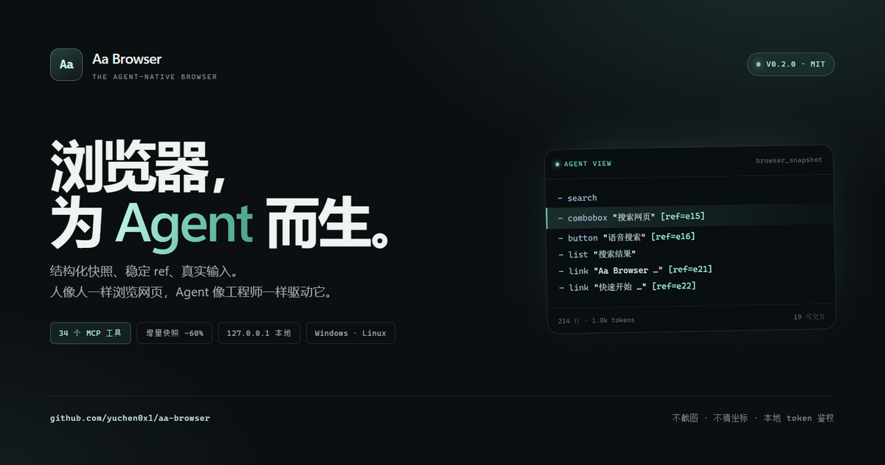

# Aa Browser

**AI エージェントのためのデスクトップブラウザ —— オープンソース、MIT ライセンス。**

<p align="center">
  <a href="./README.md">简体中文</a> ·
  <a href="./README.en.md">English</a> ·
  <a href="./README.zh-TW.md">繁體中文</a> ·
  <b>日本語</b> ·
  <a href="./README.ko.md">한국어</a> ·
  <a href="./README.es.md">Español</a> ·
  <a href="./README.pt-BR.md">Português (BR)</a> ·
  <a href="./README.fr.md">Français</a> ·
  <a href="./README.de.md">Deutsch</a> ·
  <a href="./README.ru.md">Русский</a> ·
  <a href="./README.ar.md">العربية</a> ·
  <a href="./README.hi.md">हिन्दी</a>
</p>

  

> 人が人のようにページを閲覧し、エージェントがエンジニアのように操作する。

<p align="center">
  
</p>

これは**要約版の翻訳**です。完全で正式なドキュメントは中国語で書かれています：[README.md](./README.md) と [`docs/`](./docs)。

## これは何か

従来のブラウザは「人がピクセルを見る」ために設計されていますが、AI エージェントが必要とするのは**構造化されたページデータ**です。Aa Browser は完全な Chromium デスクトップブラウザ（Electron）で、誰でも普段どおりに使えます —— タブ、オムニボックス、履歴、ダウンロード、ページ内検索、ログイン状態の永続化 —— さらにローカルの stdio ブリッジを通じて、あらゆる [MCP](https://modelcontextprotocol.io) エージェントにページを開放します。**構造化アクセシビリティスナップショット**を読み取り、クリック、入力、選択、ドラッグ、スクロール、抽出、通信キャプチャを行えます。スクリーンショットも、座標の推測も不要です。

スナップショットは既定で**インクリメンタル**です。変化のないページは 1 行で済み、小さな変更は差分だけが返り、`ref` ID はスナップショットをまたいで安定します。ブリッジは `127.0.0.1` のみをリッスンし、起動ごとのランダムなトークンを `~/.aabrowser/connection.json` に保存します。

## ハイライト

- 🖥️ **本物のブラウザ**：Electron/Chromium シェル。タブ、オムニボックス、戻る／進む、ページ内検索、ダウンロードパネル、ログイン状態の永続化を備えます。
- 🧠 **構造化スナップショット**：ページは YAML 風のアクセシビリティツリーになり、操作可能なすべての要素が `ref` ID を持ちます（`- button "ログイン" [ref=e5]`）。Playwright MCP の形式に揃えています。
- 💸 **インクリメンタルスナップショットでトークンを節約**：変化なし → 1 行。小さな変更 → 変更されたブロックのみ。ナビゲーションや大きな変更時は完全スナップショットに戻ります。長いタスクでは通常 60%+ のコンテキストを節約できます。
- 🎯 **本物の入力経路**：クリックは信頼された入力イベント（`isTrusted=true`）を使い、入力は `insertText` パイプラインと React 制御入力向けのフォールバックを使います。実際のイベントが稀に失われる場合は合成イベントで補います。
- 🤖 **MCP ネイティブ**：標準の stdio MCP ブリッジ。Codex、ZCode、Claude Code、Cursor、Windsurf、Cline、VS Code、Gemini CLI、Qwen Code、WorkBuddy から操作できます。
- 📊 **診断**：`browser_performance` は DevTools を開かずに、ナビゲーションのタイミング、初回描画、リソースサイズと低速リソース、JS ヒープ、DOM サイズを返します。
- 🌐 **バイリンガル UI**：システムまたはブラウザの言語に従うか、設定で簡体字中国語／English を固定できます。
- 🔒 **ローカル優先のセキュリティ**：ループバック限定の WebSocket、起動ごとのランダムトークン、サイト許可リスト、分離タブ、ネットワークデータのマスキング、高リスク操作のブラウザ内承認。
- 📦 **検証可能なリリース**：Windows NSIS と Linux AppImage を同一バージョンで配布し、`SHA256SUMS.txt`、GitHub の不変リリースアテステーション、CycloneDX `sbom.cdx.json` を添付します。

## スナップショットの例

Bing のホームページで `browser_snapshot` を呼び出すと、次の結果が返ります（実際の出力、逐語のまま）：

```text
页面快照 url: https://www.bing.com/
title: 搜索 - Microsoft 必应
元素数: 19

- banner "登录 Rewards 手机版"
  - img "必应"
  - navigation
    - menuitem "图片" [ref=e1]
    - menuitem "视频" [ref=e3]
- search
  - combobox "搜索网页" [ref=e15]
  - button "语音搜索" [ref=e16]
```

次にエージェントは `ref` に対して操作します：

```jsonc
{ "tool": "browser_type", "arguments": { "ref": "e15", "text": "Aa Browser", "submit": true } }
```

操作の後には**インクリメンタルスナップショット**が返ります —— 変更されたブロックのみと、追加または無効化された `ref` ID です。`browser_snapshot { full: true }` は完全なツリーを強制します。

## インストール

### プロンプト 1 つ（推奨）

[PROMPT.md](./PROMPT.md) のプロンプトを、ローカルコマンドを実行できる任意の AI に送ってください。Aa Browser が未インストールなら、公式インストーラーをダウンロードし、SHA-256 を検証し、インストール、起動、MCP 設定の書き込みを行い、実際に `browser_tabs` を呼び出して検証します。すでに実行中なら、設定の書き込みと検証だけを行います。

```bash
node install.mjs --repo yuchen0x1/aa-browser --verify --json   # download, verify, install, connect, verify
node install.mjs --connect-only --verify --json                 # already installed: connect and verify only
node install.mjs --verify-only                                  # verify the browser side, write nothing
node install.mjs --print-config                                 # print a generic MCP config fragment (pure JSON)
```

インストーラーが対話的に質問することはありません。`--clients zcode,cursor` は設定するクライアントを限定し、`--dir <dir>` はインストール先を上書きし、`--no-launch` は起動をスキップし、`--sha256 <hex>` は期待するインストーラーのハッシュを固定します。他の MCP クライアントは `--print-config` の出力を利用できます。

### Windows

[GitHub Releases](https://github.com/yuchen0x1/aa-browser/releases/latest) から `aa-browser-setup-<version>.exe` をダウンロードして実行します。インストーラーは**コード署名されていません**：SmartScreen が表示されたら「詳細情報 → 実行」を選んでください。各リリースには `SHA256SUMS.txt`、`sbom.cdx.json`、不変リリースアテステーションも添付されるので、ファイルを自分で検証できます。

### Linux AppImage

`aa-browser-<version>-linux-x86_64.AppImage` をダウンロードし、実行権限を付けて現在のデスクトップセッションから起動します。GTK 3、NSS、GBM、オーディオライブラリ、動作する Chromium サンドボックスが必要です。MCP アクセスにはシステムの Node.js 22.12 以降が必要です。

```bash
mkdir -p ~/Applications
mv aa-browser-<version>-linux-x86_64.AppImage ~/Applications/AaBrowser.AppImage
chmod u+x ~/Applications/AaBrowser.AppImage
~/Applications/AaBrowser.AppImage
```

FUSE がない場合は `APPIMAGE_EXTRACT_AND_RUN=1 ~/Applications/AaBrowser.AppImage` で起動します。ディストリビューション別の対応状況と復旧手順は[プラットフォームガイド](./docs/PLATFORMS.md)を参照してください。

### ソースから

Node.js 22.12 以降が必要です。

```bash
git clone https://github.com/yuchen0x1/aa-browser.git aa-browser
cd aa-browser
npm ci             # downloads Electron on first run
npm run build      # main, preload, renderer, MCP bridge and DeepSeek Harness plugin bridge
npm start          # launch the built app
```

レンダラーがホットリロードされる開発モードは `npm run dev` です。専用の `aa-browser-dev` ユーザーデータディレクトリを使うため、インストール版と同時に実行できます。

## エージェントを接続する

前提条件：Aa Browser が起動していること（ポートとトークンを `~/.aabrowser/connection.json` に書き込みます）、クライアントが stdio MCP に対応していること、そして両方が同じマシン上で同じユーザーとして動作していることです。

- **ワンクリック**：設定 → AI クライアントに接続 → クライアントにチェック → 書き込み。その後クライアントを再起動してください。
- **手動**：`node install.mjs --print-config` を実行し、出力された `command` / `args` / `env` をクライアント設定に貼り付けます。既存の設定は `<file>.aa-backup-<timestamp>` にバックアップされ、`aa-browser` エントリだけが変更され、書き込みは冪等です。

### 状態と検証

| ツールバーの状態 | 意味 |
| --- | --- |
| AI 接続待ち | MCP ブリッジがまだ接続していません：設定がない、クライアントを再起動していない、またはブラウザが起動していない |
| AI の初回呼び出し待ち | ブリッジは接続・認証済みですが、ツール呼び出しがまだ一度も成功していません |
| AI 接続済み ×N | 少なくとも 1 回の `browser_tabs` リスト呼び出しが成功しています。N は検証済みのブリッジ数です |

設定が書き込まれていることは、**動作する接続**を意味しません。`node install.mjs --verify-only` で検証するか、エージェントに実際に `browser_tabs` を呼び出させてください。

## MCP ツール

5 つのグループに **34 個のツール**：ナビゲーションとスナップショット（4）、操作（9）、読み取りと状態（12）、ネットワークと Mock（6）、診断とタブ（3）。クライアント側のツール名には `mcp__aa-browser__` プレフィックスが付く場合があります。

| グループ | ツール |
| --- | --- |
| ナビゲーションとスナップショット | `browser_navigate`, `browser_snapshot`, `browser_navigate_back`, `browser_navigate_forward` |
| 操作 | `browser_click`, `browser_type`, `browser_fill_form`, `browser_select_option`, `browser_drag`, `browser_hover`, `browser_scroll`, `browser_press_key`, `browser_upload_file` |
| 読み取りと状態 | `browser_extract`, `browser_evaluate`, `browser_dialogs`, `browser_wait`, `browser_screenshot`, `browser_find`, `browser_get_selector`, `browser_cookies`, `browser_storage`, `browser_downloads`, `browser_pdf`, `browser_console` |
| ネットワークと Mock | `browser_network_requests`, `browser_network_detail`, `browser_har`, `browser_mock_requests`, `browser_list_mocks`, `browser_clear_mocks` |
| 診断とタブ | `browser_performance`, `browser_resize`, `browser_tabs` |

共通の動作：ほとんどのツールは結果と一緒にスナップショットを返します（`snapshot: false` で省略できます）。`browser_resize` と `browser_downloads` を除くすべてのツールは `tabId` を受け付け、1 回の呼び出しは 180 秒でタイムアウトし、承認は最大 120 秒待機し、ネットワーク詳細は既定でマスキングされます。ツールの完全なマニュアルは [site/tools.html](./site/tools.html) にあります。

## セキュリティ

- エージェントサービスは `127.0.0.1` のみをリッスンし、起動ごとにランダムなトークンを使用し、非ローカルオリジンを拒否します。ポートとトークンは `~/.aabrowser/connection.json` にあり、正常終了時に削除されます。
- ページビューは preload スクリプトなしで動作し、スナップショットと操作スクリプトはメインプロセスが注入します。ナビゲーションは `http:` / `https:` のみを許可し、`file:`、`data:`、`devtools:` などのプロトコルは拒否されます。
- 機密入力フィールドはユーザー自身が入力する必要があります：エージェントが提供したテキストは書き込まれず、読み取られず、返されません。「高リスク操作の確認」を有効にすると、フォーム送信、入力後の Enter、未マスキングのネットワークアクセスはブラウザ内の承認を待ちます（120 秒で拒否扱い）。
- ネットワーク詳細と HAR エクスポートは、既定で認証ヘッダーと資格情報らしきパラメーターをマスキングします。
- **サイト許可リスト**：ナビゲーションにのみ適用され、空欄なら無効になります。空欄のままでも `file:`、`data:`、`devtools:` などの非 Web プロトコルは許可されません。
- **エージェント接続で変わるのは 1 つのエントリだけ**：書き込み前にクライアントの既存設定をバックアップし、`aa-browser` エントリだけを変更し、token やパスワードは一切書き込みません。インストーラーのダウンロードでは Release の SHA-256 digest とファイルヘッダーを検証します。
- 分離タブは別のセッションパーティションを使います：Cookie とログインを共有せず、閉じると削除され、グローバル履歴、最近閉じたタブの一覧、セッション復元から除外されます。
- **境界**：エージェントは Cookie、ストレージ、ヘッダー、レスポンスボディを含むページ内容と通信を閲覧できます。これらの制御は緩和策であり、汎用 DLP ではありません —— 信頼できないエージェントを高機密サイトに向けないでください。

脆弱性は [SECURITY.md](./SECURITY.md) の非公開報告で報告してください。公開 issue には書かないでください。

## プラットフォームと制限

| プラットフォーム | 公式ビルド | 備考 |
| --- | --- | --- |
| Windows 11 x64 | NSIS インストーラー | 活発に保守され、CI とローカル回帰テストでカバーされています |
| Windows 10 x64 | 同じインストーラー | Windows 11 のビルドを共有します。実機でのアップグレード受け入れは未完了です |
| Linux x86_64（Ubuntu デスクトップ） | AppImage | システムの Node.js 22.12+ が必要です。他のディストリビューションは実機検証が必要です |
| Windows ARM64 / macOS / Android / iOS | なし | インストーラーはインストールを装わず、明確に拒否します |

既知の制限：

- Windows では**コード署名なし**：SmartScreen が警告し、「詳細情報 → 実行」が必要です。
- **Chrome の代替ではありません**：ブックマーク、拡張機能、アカウント／複数端末同期はありません。範囲は「ブラウザコア + エージェントアクセス」です。
- **Linux の MCP アクセスにはシステムの Node.js 22.12+ が必要**です。Windows ではシステム Node が見つからない場合、同梱のランタイムを使用します。
- **セッション復元には範囲があります**：通常の Web タブのみ、最大 20 件、分離タブ、内部ページ、非 HTTP(S) URL は決して含みません。
- **ユーザーデータディレクトリごとに 1 インスタンス**。開発版は独自のディレクトリを使うため、両方を同時に実行できます。
- **インストールと更新は GitHub Releases に依存**します。AppImage の自己更新には書き込み可能なディレクトリが必要です。

## ドキュメント

詳細なドキュメントは現在中国語です：

| ドキュメント | 内容 |
| --- | --- |
| [docs/CONNECT.md](./docs/CONNECT.md) | プラットフォームとクライアントのマトリクス、インストーラーのフラグ、手動手順、トラブルシューティング |
| [docs/PLATFORMS.md](./docs/PLATFORMS.md) | リリースマトリクス、Linux の依存関係、アンインストールとデータ復旧 |
| [docs/AUTO_UPDATE.md](./docs/AUTO_UPDATE.md) | 更新確認、ダウンロード、再起動してインストール、SHA-512 とロールバック |
| [docs/MARKETPLACE.md](./docs/MARKETPLACE.md) | DeepSeek Harness プラグインのインストールと検証 |
| [docs/MAINTENANCE.md](./docs/MAINTENANCE.md) | リリース証跡、回帰記録、保守の境界 |
| [リリースノート](./docs/releases/release-notes.md) / [CHANGELOG](./CHANGELOG.md) | バージョンごとの変更履歴 |
| [site/tools.html](./site/tools.html) | 34 ツールの完全なマニュアル（ローカルで開けばよく、デプロイ不要） |

## コントリビューションとライセンス

バグ報告、機能の議論、ドキュメント修正、PR を歓迎します —— まず [CONTRIBUTING.md](./CONTRIBUTING.md) をお読みください。MCP ツールを追加するときは、`src/main/tools.ts`、`cli/mcp.mjs`、この README のツール表、`site/tools.html` をまとめて更新してください。`npm run check` が最初の 3 つが同期しているかを検証します。

MIT licensed —— 詳細は [LICENSE](./LICENSE) © Aa Browser contributors。

この翻訳は中国語の原文より遅れることがあります。この README の翻訳は [README.md](./README.md)（简体中文）と `README.<language>.md` で管理されています。完全な一覧は `docs/i18n/readme-languages.json` を参照してください。