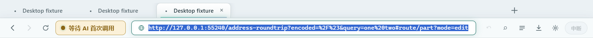

# Aa Browser

**为 AI Agent 提供独立登录身份、可恢复工作流与人工审批的开源桌面浏览器运行平台。**

    [](https://m8ven.ai/mcp/yuchen0x1-aa-browser-135ffo?s=readme)

> 人像人一样浏览网页，Agent 像工程师一样驱动它。
> **The Agent-Native Browser** — snapshots, actions, and packet capture over MCP.

<p align="center">
  <b>简体中文</b> ·
  <a href="./docs/i18n/readmes/README.en.md">English</a> ·
  <a href="./docs/i18n/readmes/README.zh-TW.md">繁體中文</a> ·
  <a href="./docs/i18n/readmes/README.ja.md">日本語</a> ·
  <a href="./docs/i18n/readmes/README.ko.md">한국어</a> ·
  <a href="./docs/i18n/readmes/README.es.md">Español</a> ·
  <a href="./docs/i18n/readmes/README.pt-BR.md">Português (BR)</a> ·
  <a href="./docs/i18n/readmes/README.fr.md">Français</a> ·
  <a href="./docs/i18n/readmes/README.de.md">Deutsch</a> ·
  <a href="./docs/i18n/readmes/README.ru.md">Русский</a> ·
  <a href="./docs/i18n/readmes/README.ar.md">العربية</a> ·
  <a href="./docs/i18n/readmes/README.hi.md">हिन्दी</a>
</p>

> 其他语言版本是精简导读，安装、接入、安全与工具的权威细节以本文件为准。语言清单见 [`docs/i18n/readme-languages.json`](./docs/i18n/readme-languages.json)。

<p align="center">
  
</p>

## 最新更新

<!-- github-release:start -->

**[v0.17.0](https://github.com/yuchen0x1/aa-browser/releases/tag/v0.17.0)** · 2026-11-24 · 最新正式版（Windows x64、Linux x86_64）

GitHub Release 更新支持官方线路优先、代理回退、断点续传和可信摘要/大小校验；尚未在中国大陆网络或完整 Release 大包上实测。Windows 安装包仍未 Authenticode 签名。

[全部发行记录](https://github.com/yuchen0x1/aa-browser/releases)

<!-- github-release:end -->

从旧版本升级：打开「设置 → 软件更新」检查、下载并重启安装；升级后新功能才会生效。完整版本历史见[发布说明](./docs/releases/release-notes.md)与 [CHANGELOG](./CHANGELOG.md)。

Aa Browser 是一个完整的 Chromium 桌面浏览器，任何人都可以正常使用它上网；同时它通过本地 MCP 桥把页面能力开放给支持 [MCP](https://modelcontextprotocol.io)（Model Context Protocol）的 Agent：优先读取**结构化快照**（可访问性树 + 元素 ref 编号），执行点击、输入、选择、滚动、提取和抓包。Canvas、图表等结构化信息不足的页面可使用截图与受保护的坐标操作补充。

它适合后台运营、数据采集、回归验证、抓包排障，以及把重复的网页操作交给模型。工作账号、个人账号与测试账号可以放在独立 Profile 中，Agent 和工作流显式绑定对应环境；有副作用的中断步骤需要先检查页面，再由人批准重试。

当前源码面向 **v0.19.0**：保留原有 **47 个 MCP 工具**，增加 6 个平台入口，共 **53 个工具**。已发布版本与安装包以顶部正式发行链接为准。

## 目录

- [特性](#特性)
- [演示](#演示)
- [快照示例](#快照示例)
- [架构](#架构)
- [快速开始](#快速开始)
  - [一键接入（推荐）](#一键接入推荐)
  - [Windows 安装包](#windows-安装包)
  - [Linux AppImage](#linux-appimage)
  - [源码运行](#源码运行)
  - [自动更新](#自动更新)
- [接入你的 Agent](#接入你的-agent)
  - [客户端配置位置](#客户端配置位置)
  - [连接状态与验证](#连接状态与验证)
- [Profile 与工作流](#profile-与工作流)
- [MCP 工具](#mcp-工具)
- [界面与快捷键](#界面与快捷键)
- [安全说明](#安全说明)
- [本地数据与卸载](#本地数据与卸载)
- [平台支持](#平台支持)
- [已知限制](#已知限制)
- [故障排查](#故障排查)
- [项目结构](#项目结构)
- [开发与测试](#开发与测试)
- [文档](#文档)
- [常见问题](#常见问题)
- [贡献](#贡献)
- [许可](#许可)
- [致谢](#致谢)

## 特性

- 🖥️ **真浏览器**：基于 Electron（Chromium），标签页 / 地址栏 / 前进后退 / 页面查找 / 下载面板 / 登录态持久化，一应俱全
- 🧠 **结构化快照**：页面被转换成 YAML 风格的可访问性树，每个可交互元素带 `ref` 编号（`- button "登录" [ref=e5]`），格式对齐 Playwright MCP 生态，Agent 零学习成本
- 💸 **增量快照省 token**：页面没变 → 一行回复；小变化 → 只返回变更区块；ref 跨快照稳定复用（React 重渲染也能靠内容签名接上）；跳转 / 大变化自动回退完整快照。长任务通常能省 60%+ 上下文
- 🤖 **MCP 原生接入**：标准 stdio MCP 桥，Codex / ZCode / Claude Code / Cursor 等 MCP 客户端均可驱动
- 🎯 **真实输入路径**：点击走受信任的输入事件（`isTrusted=true`），输入走 `insertText` 管线并对 React 受控组件兜底；真实事件偶发丢失时自动补发合成事件，不会「调用成功但页面没动」
- 🔁 **动作后自动快照**：每次点击 / 输入 / 滚动后自动返回新快照，Agent 无需二次请求即可继续决策
- 📊 **性能诊断**：`browser_performance` 一次返回导航耗时、首绘、资源体积与慢资源、JS 堆和 DOM 规模，Agent 不开 DevTools 也能解释慢页面
- 🌐 **中英双语界面**：跟随系统 / 浏览器语言，也可在设置里固定简体中文或 English
- 🧭 **地址栏历史补全**：本地记录最近 1000 条访问，按域名 / URL 前缀 / 标题补全并加权排序；隔离标签不写入
- 🧩 **已解压扩展**：按 Profile 加载本地 MV2 / MV3 扩展，查看版本、权限、来源，启用、禁用、卸载并检查本地版本变化；一次性隔离标签不加载扩展
- **独立浏览器身份**：Profile 使用独立的持久化 Chromium Session，分开 Cookie、Storage、IndexedDB、登录态、缓存、历史、下载目录、代理和扩展登记；旧版默认环境保留原分区
- **可恢复工作流**：复用既有工具执行依赖步骤，持久化步骤状态、重试计数、检查点与审计事件；只读失败有界重试，不自动重放中断的写操作
- **网络与故障诊断**：按 Profile 设置系统、直连或 HTTP/HTTPS/SOCKS5 代理，检测真实路由、连通性与本机 DNS；诊断面板汇总 Renderer、MCP、任务、CPU 和内存
- 🗂️ **标签与会话恢复**：`Ctrl+Shift+T` 恢复本次运行中最近关闭的标签（最多 20 个）；重启后按上次顺序恢复普通网页标签与活动标签，隔离标签、内部页和非 HTTP(S) 地址不恢复，地址中的账号密码会被剥离
- 🛡️ **Agent 可观测、可接管**：工具栏实时显示连接状态，Agent 操作浏览器时窗口四周显示闪烁光圈、右下角显示当前工具；活动日志保留最近 30 条操作；敏感输入由用户亲自填写，高危操作走浏览器内审批。AI 操作网页时页面默认只读：点击网页或 HUD 的「接管页面」会立即暂停 AI 并把操作权交给你，首次点击只用于接管、不会误触网页；操作完点「继续 AI」恢复，接管期间不会自动恢复。工具栏「中断」仍会取消所有调用并暂停 30 秒，随后自动恢复，也可随时手动恢复。长操作（导航 / 等待 / 整页截图 / 多视口矩阵 / 视觉对比）会按 MCP 规范回传 `notifications/progress`；多客户端并发时 HUD 列出每个调用及其进度，并可「停止」单个调用而不影响其他客户端
- 🧩 **长页面与证据治理**：超长页面可用 `browser_snapshot {maxNodes, cursor}` 分页且跨页 ref 仍有效；closed shadow DOM 内的元素也能被快照与点击；截图 / HAR / PDF / 视觉基线自动登记 sha256、大小与 TTL，按配额清理临时证据而保留用户数据
- 🖱️ **下载与权限可控**：下载可取消 / 重试（重试重新校验站点白名单）；摄像头 / 麦克风 / 定位 / 通知请求进入人工审批，允许后仅在该会话内生效；原生右键菜单跟随语言设置，并带图片另存与打印
- 🔒 **本地安全**：WebSocket 仅监听 `127.0.0.1`，每次启动随机 token，拒绝非本机来源；另有站点白名单、隔离会话与网络数据脱敏
- 🔌 **一段接入**：把新标签页或 [PROMPT.md](./PROMPT.md) 里的通用提示词发给任意具备本机执行能力的 AI，自动完成下载、安装、MCP 配置和 `browser_tabs` 验证；配置指向稳定桥路径，随应用升级
- 📦 **可验证发行**：当前正式版提供 Windows NSIS 安装包与 Linux AppImage，附 `SHA256SUMS.txt`、GitHub 不可变发行证明和 CycloneDX `sbom.cdx.json`

## 演示

<p align="center">
  <a href="./docs/media/aa-browser-demo.mp4">
    
  </a>
</p>

15 秒录屏。点击画面或[观看原片（MP4，1280×720，约 1.9 MB）](./docs/media/aa-browser-demo.mp4)；GitHub 的 README 不支持内嵌视频播放，这里用一份等长动图预览代替。

### 地址栏编辑

聚焦地址栏或按 `Ctrl/Cmd+L` 时编辑完整地址，保留协议、查询参数与 `#` 路由；未编辑直接回车不会改变原地址。按 Esc 先收起历史建议，再按一次取消编辑。以下截图来自本地真实 Electron 回归页面：



## 快照示例

在必应首页调用 `browser_snapshot` 得到：

```text
页面快照 url: https://www.bing.com/
title: 搜索 - Microsoft 必应
元素数: 19

- banner "登录 Rewards 手机版"
  - img "必应"
  - navigation
    - menuitem "图片" [ref=e1]
    - menuitem "视频" [ref=e3]
- search
  - combobox "搜索网页" [ref=e15]
  - button "语音搜索" [ref=e16]
```

Agent 随后：

```jsonc
{ "tool": "browser_type", "arguments": { "ref": "e15", "text": "Aa Browser", "submit": true } }
```

点击 / 输入后自动返回的是**增量快照**——只有变化的区块：

```text
页面快照（增量） url: https://www.bing.com/search?q=Aa+Browser
title: Aa Browser - 搜索
变化: +6 / -1（共 214 行，其余未变，仍以上次快照为准）

  - search
+ - link "agent-browser.dev" [ref=e37]
+ - text "Browser automation for AI agents …"
- - text "（旧的空白提示）"

新增 ref: e37 e38
失效 ref: e12
```

页面未变化时只回一行（≈50 token）；跳转到新页面或变化过大时自动回退完整快照。`browser_snapshot { full: true }` 可强制完整树。完整的工具清单见下文 [MCP 工具](#mcp-工具)。

## 架构

```text
┌─────────────────────────────────────────────────────┐
│                Aa Browser (Electron)                │
│  ┌───────────────────────────────────────────────┐  │
│  │  外壳 UI（标签栏 / 地址栏 / 设置）←→ 主进程 IPC │  │
│  └───────────────────────────────────────────────┘  │
│  ┌───────────────────────────────────────────────┐  │
│  │  页面标签 WebContentsView × N                 │  │
│  │    └─ 注入快照引擎（DOM → YAML 树 + ref 表）  │  │
│  └───────────────────────────────────────────────┘  │
│  ┌───────────────────────────────────────────────┐  │
│  │  Agent 服务 ws://127.0.0.1:<随机端口>         │  │
│  │    ~/.aabrowser/connection.json（端口 + token）│  │
│  └───────────────────────────────────────────────┘  │
└──────────────────────────┬──────────────────────────┘
                           │ 本地 WebSocket（token 鉴权）
┌──────────────────────────┴──────────────────────────┐
│  cli/mcp.mjs → out/bridge/mcp.cjs（stdio MCP 桥）   │
│    MCP 客户端：Codex / ZCode / Cursor / Claude Code │
└─────────────────────────────────────────────────────┘
```

端口与 token 由应用在启动时生成并写入 `~/.aabrowser/connection.json`（正常退出时删除）；MCP 桥通过它发现浏览器。若浏览器尚未运行，桥在第一次 `tools/call` 时会从受信安装路径自动启动 Aa Browser，并等待 WebSocket 就绪；可用 `AA_BROWSER_APP_PATH` 指定绝对可执行文件路径，用 `AA_BROWSER_AUTO_LAUNCH=0` 禁用自动启动。升级应用一般不需要重写客户端配置。页面视图不挂 preload，快照与动作脚本由主进程注入。发布版使用 `out/bridge/mcp.cjs`——由 `cli/mcp.mjs` 构建出的单文件零依赖产物，安装后无需 `node_modules`。

## 快速开始

| 你的情况 | 建议路径 |
| --- | --- |
| 想最快接上 AI，且有一个能执行本机命令的 AI | [一键接入（推荐）](#一键接入推荐) |
| 想自己手动安装 | [Windows 安装包](#windows-安装包) / [Linux AppImage](#linux-appimage) |
| 想改代码或自行构建 | [源码运行](#源码运行) |

### 一键接入（推荐）

把 [PROMPT.md](./PROMPT.md) 中的提示词整段发给任意具备本机命令执行能力的 AI（WorkBuddy、ZCode、Codex/ChatGPT 桌面端、Claude Code、Cursor、Windsurf、Cline、VS Code、Gemini CLI、Qwen Code、DeepSeek Harness 等）。

- **还没安装 Aa Browser**：AI 会下载官方安装器，自动选择平台、校验 SHA-256、安装并启动，再写入 MCP 配置。
- **已经下载并打开了 Aa Browser**：点新标签页的「复制接入提示词」，AI 会跳过安装，只写配置并实际调用 `browser_tabs` 列表验证。
- **已经下载 Aa Browser 但尚未打开**：AI 写入配置后，第一次调用 `browser_tabs` 时 MCP 桥会自动启动浏览器并等待连接；也可以先手动打开再验证。
- **网页版 ChatGPT 等没有本机执行能力的环境**：提示词要求 AI 明确说明无法自动安装并给出手动步骤，不会假装成功。

安装器写入前会备份客户端配置，只修改 `aa-browser` 一个条目；配置指向稳定桥路径，应用升级后一般无需重写。完整平台 / 客户端矩阵、参数和排查见[通用安装与接入](./docs/CONNECT.md)。

手动等效命令（AI 不可用时）：

```bash
node install.mjs --repo yuchen0x1/aa-browser --verify --json   # 下载、校验、安装、接入并验证
node install.mjs --connect-only --verify --json                 # 已安装，只接入并验证
node install.mjs --verify-only                                  # 只验证浏览器侧连接，不写配置
node install.mjs --print-config                                 # 输出通用 MCP 配置片段（stdout 是纯 JSON）
```

常用参数：

| 参数 | 作用 |
| --- | --- |
| `--repo yuchen0x1/aa-browser` | 从官方 GitHub Releases 安装最新版 |
| `--connect-only` | 跳过安装，只写配置（可配合 `--verify`） |
| `--verify` / `--verify-only` | 安装 / 接入后实际调用 `browser_tabs` 验证 / 只验证 |
| `--json` | 机器可读输出，日志走 stderr |
| `--clients zcode,cursor` | 只配置指定客户端 |
| `--dir <目录>` | Windows 安装目录 / Linux AppImage 存放目录 |
| `--no-launch` | 安装后不自动启动浏览器 |
| `--sha256 <hex>` | 显式校验安装包哈希 |
| `--print-config` | 只输出通用 MCP 配置片段 |

安装器从不交互提问；`--yes` 只是兼容提示词的无人值守开关。自动写入配置的客户端：ZCode、Claude Code、Cursor、Windsurf、Cline、VS Code、Gemini CLI、Qwen Code、OpenCode、Codex、WorkBuddy。DeepSeek Harness 通过插件市场手动接入（安装器不会修改 `.dsh`）；其他客户端可用 `--print-config` 获取通用配置。DeepSeek Harness 可直接安装插件市场的 Aa Browser 插件（见[插件市场接入](./docs/MARKETPLACE.md)）。

WorkBuddy 会写入用户级 `~/.workbuddy/mcp.json` 并生成本地 Connector；配置写入、Connector 导入 / 启用、bridge 鉴权、工具调用成功是不同状态，必须由 WorkBuddy 实际调用 `browser_tabs` 后才能报告已连接。不要改写 WorkBuddy 数据库、缓存或内部运行时文件。

### Windows 安装包

从 [GitHub Releases](https://github.com/yuchen0x1/aa-browser/releases/latest) 下载 `aa-browser-setup-<版本>.exe`，双击安装。安装包未做代码签名，Windows SmartScreen 提示时选「更多信息 → 仍要运行」。

同一 Release 还提供 `SHA256SUMS.txt`、`sbom.cdx.json` 和 GitHub 不可变发行证明，可自行核对文件来源与依赖清单。

首次打开后，新标签页会提供安装与连接提示词：具备本机终端和文件操作能力的 AI 可以按提示从官方仓库下载安装、写入客户端配置，并在重启 / 重新加载后实际调用 `browser_tabs` 验证。只有 AI 实际成功调用 `browser_tabs` 的列表操作，工具栏才显示「AI 已连接」；配置写入成功本身不代表接通。

需要在本地打出安装包时（维护者）：

```bash
npm run dist -- --publish never  # 产出 release/aa-browser-setup-<版本>.exe
```

### Linux AppImage

v0.17.0 提供 Linux AppImage；Ubuntu 24.04 的 Xvfb 桌面、打包、AppImage 启动和 MCP 桥连接由标签 CI 验证，其他发行版和桌面环境仍需实机确认。下载 `aa-browser-0.17.0-linux-x86_64.AppImage`，赋予执行权限后从当前桌面会话启动。需要 GTK 3、NSS、GBM、音频库以及可用的 Chromium 沙箱；MCP 接入需要系统 Node.js 22.12 或更高版本。

```bash
mkdir -p ~/Applications
mv aa-browser-0.17.0-linux-x86_64.AppImage ~/Applications/AaBrowser.AppImage
chmod u+x ~/Applications/AaBrowser.AppImage
~/Applications/AaBrowser.AppImage
```

没有 FUSE 时可用 `APPIMAGE_EXTRACT_AND_RUN=1 ~/Applications/AaBrowser.AppImage` 启动。系统依赖、按发行版验证状态和恢复步骤见[平台指南](./docs/PLATFORMS.md)。

### 源码运行

开发和打包使用 Node.js 22.12 或更高版本。

```bash
git clone https://github.com/yuchen0x1/aa-browser.git aa-browser
cd aa-browser
npm ci             # 首次会下载 Electron，慢可设镜像：
                   # export ELECTRON_MIRROR=https://npmmirror.com/mirrors/electron/
npm run build      # 构建主进程 / 预加载 / 渲染层 / MCP 桥 / DeepSeek Harness 插件桥
npm start          # 启动 Aa Browser（预览构建产物）
```

开发模式（热更新渲染层）：

```bash
npm run dev
```

开发版使用独立的 `aa-browser-dev` 用户数据目录，不会和安装版抢单实例锁、登录态或 `connection.json`，两者可以同时运行。

### 自动更新

Windows NSIS 安装版和 Linux AppImage 都从 GitHub Releases 检查更新。打开「设置 → 软件更新」可以检查、查看下载状态并确认重启安装；下载完成后只有用户确认才会交给安装器。默认稳定版通道，也可切换到 Beta；网络失败会按 1 / 5 / 15 分钟退避重试，也可手动重试。AI 正在操作浏览器时会先提示重启会中断当前步骤。更新后桥会自动重连，只读且幂等的在途调用会重发；写操作不会重放，标签 id 会随会话恢复保留。安装流程、SHA-512 校验与回滚方法见[自动更新](./docs/AUTO_UPDATE.md)。

## 接入你的 Agent

### 前提

- Aa Browser 已安装；它会在 `~/.aabrowser/connection.json` 写入本地端口与 token，浏览器未运行时 MCP 桥会在第一次工具调用时自动拉起它。
- 客户端支持 stdio MCP；浏览器与客户端在同一台机器、同一个用户账户下。

### 方式 A · 一键接入（推荐）

Aa Browser 工具栏「设置」→「连接 AI 客户端」→ 勾选 → 写入，然后重启 AI 客户端，并让它实际调用 `browser_tabs` 的列表操作。工具栏显示「AI 已连接」才算验证通过；MCP 桥连上但尚未成功调用工具时会显示「等待 AI 首次调用」。

命令行等效：`node cli/setup.mjs --yes`（`--list` 查看客户端，`--client zcode,cursor` 指定目标）。

### 方式 B · 手动写入通用配置

先运行 `node install.mjs --print-config`，它会输出当前安装可用的 `command` / `args` / `env`，直接粘贴到客户端即可。下面是配置的形态（Windows 示例，路径和 `env` 不要照抄）：

```jsonc
{
  "mcpServers": {
    "aa-browser": {
      "command": "node",
      // 路径以 node install.mjs --print-config 的输出为准
      "args": ["C:\\path\\to\\Aa Browser\\resources\\app.asar.unpacked\\out\\bridge\\mcp.cjs"]
    }
  }
}
```

打包版自带的 Node 运行时可能写成 `"command": "C:\\...\\Aa Browser.exe"` 并附带 `"env": { "ELECTRON_RUN_AS_NODE": "1" }`，同样以 `--print-config` 的输出为准。

### 客户端配置位置

| 客户端 | 自动写入 | 配置文件 / 接入方式 |
| --- | --- | --- |
| ZCode | 是 | `~/.zcode/cli/config.json`（`mcp.servers`） |
| Claude Code | 是 | `~/.claude.json`（`mcpServers`） |
| Cursor | 是 | `~/.cursor/mcp.json`（`mcpServers`） |
| Windsurf | 是 | `~/.codeium/windsurf/mcp_config.json`（`mcpServers`） |
| Cline（VS Code 扩展） | 是 | `%APPDATA%\Code\User\globalStorage\saoudrizwan.claude-dev\settings\cline_mcp_settings.json`（JSONC） |
| VS Code（原生 MCP） | 是 | `%APPDATA%\Code\User\mcp.json`（`servers`，需要 `type`） |
| Gemini CLI | 是 | `~/.gemini/settings.json`（`mcpServers`） |
| Qwen Code | 是 | `~/.qwen/settings.json`（`mcpServers`） |
| OpenCode（开源项目：[anomalyco/opencode](https://github.com/anomalyco/opencode)） | 是 | Windows `%APPDATA%\opencode\opencode.json`；macOS `~/Library/Application Support/opencode/opencode.json`；Linux `$XDG_CONFIG_HOME/opencode/opencode.json`（`mcp`，`type: local`） |
| Codex（桌面端 / CLI / IDE） | 是 | `~/.codex/config.toml`（`mcp_servers`，TOML） |
| WorkBuddy | 是 | `~/.workbuddy/mcp.json` + 本地 Connector |
| DeepSeek Harness | 插件市场手动接入 | 安装/启用 Aa Browser 插件；工具以 `mcp__aa-browser__*` 出现；不会改写 `.dsh` 配置、数据库或缓存 |
| 其他 MCP 客户端 | 手动 | `node install.mjs --print-config` 后按客户端文档粘贴 |

写入前自动备份原配置为 `<文件>.aa-backup-<时间戳>`，只改 `aa-browser` 一个键，幂等可重复执行；配置文件存在但无法解析时会跳过自动写入并提示手动配置，不会硬写坏原文件。Linux 上 VS Code 配置位于 `~/.config/Code/User/`。

### 连接状态与验证

| 工具栏状态 | 含义 |
| --- | --- |
| 等待 AI 连接 | 还没有 MCP 桥连上：配置没写入、客户端没重启，或浏览器没运行 |
| 等待 AI 首次调用 | 桥已连上并完成鉴权，但还没有一次成功的工具调用 |
| AI 已连接 ×N | 至少一次 `browser_tabs` 列表调用成功；N 为已验证的桥连接数 |

「配置写入成功」不等于接通。命令行验证：`node install.mjs --verify-only`。DeepSeek Harness 场景先确认 `~/.aabrowser/dsh-bridge.cjs` 存在，再让 Agent 实际调用一次 `mcp__aa-browser__browser_tabs`；工具出现在列表里只证明桥启动成功，不能证明浏览器可达。

然后让 Agent 干活，例如：「用浏览器打开 GitHub trending，把前 10 个项目整理成表格」或「打开 xx 后台，把登录后的接口响应都抓给我看」。

## MCP 工具

共 **53 个**工具：原有 47 个名称与核心参数保留，新增 6 个平台管理入口。工具名在客户端可能带 `mcp__aa-browser__` 前缀（如 `mcp__aa-browser__browser_tabs`），以客户端实际展示为准。

共享行为：

- 导航与多数动作工具默认在结果里附带一份快照；`snapshot: false` 可跳过，`browser_snapshot { full: true }` 强制完整树。
- 所有工具新增可选 `profileId`。省略时使用当前 MCP 客户端绑定的 Profile，否则使用默认 Profile；`tabId` 只对声明了该参数的页面工具生效。`browser_resize` 仍调整共享桌面窗口尺寸。
- 浏览器未运行时，桥返回 `isError` 工具结果而不是挂起；桥每 5 秒重试连接，启动浏览器后无需重启客户端。
- 单次调用超时 180 秒；等待人工审批最长 120 秒，超时按拒绝处理。
- 网络详情与 HAR 默认脱敏；响应体额外对 JSON、表单和常见授权文本做内容级脱敏，并在 MCP 边界限制为最多 1 MiB。敏感读取、坐标写操作和平台配置修改使用明确的权限或人工审批，调用参数不能自行授权。

**导航与快照**

| 工具 | 说明 |
| --- | --- |
| `browser_navigate` | 导航到 URL（非 URL 文本自动转搜索词；结果内嵌完整快照，`snapshot: false` 可跳过）。SPA 可用 `waitFor: { selector / text / urlContains, timeoutMs }` 等真实内容渲染；超时返回 `isError` 与当前快照 |
| `browser_reload` | 刷新当前或指定标签页；`hard: true` 绕过缓存，默认返回刷新后快照 |
| `browser_snapshot` | 结构化页面快照（默认增量省 token；`full: true` 强制完整树）。长页面可用 `maxNodes` 分页，响应给出 `nextCursor`，跨页 ref 仍有效 |
| `browser_navigate_back` / `browser_navigate_forward` | 历史后退 / 前进（返回增量快照） |

**交互**

| 工具 | 说明 |
| --- | --- |
| `browser_click` | 按 ref 点击（支持左键 / 右键 / 双击，自动返回增量快照） |
| `browser_type` | 按 ref 输入文本（支持 `submit` 回车提交、`clear` 清空） |
| `browser_fill_form` | **批量填写**：一次调用填多个字段（文本 / 下拉 / 复选），末尾只回一次快照 |
| `browser_select_option` | 按 ref 选择下拉项（按 value 或可见文本匹配） |
| `browser_drag` | 按 ref 拖拽（拖到目标元素 `toRef` 或相对偏移 `dx, dy`，支持滑块与看板） |
| `browser_hover` | 按 ref 悬停（真实 mouseMove，触发悬停菜单 / 提示） |
| `browser_scroll` | 滚动页面（先主文档，后该方向上最大的滚动区域；默认 700px，上限 3000px）。返回真实前后位置、`didScroll`、`atLimit`、`visibilityState` 与未滚动原因，不再把静默无操作报告为成功 |
| `browser_press_key` | 按键：Enter / Escape / Tab / 方向键 / PageUp / PageDown / F1-F12 / 单字符；支持 `modifiers: [ctrl, alt, shift, meta]` 及 `Ctrl+C` / `Ctrl+Shift+R` 等组合 |
| `browser_upload_file` | 向 `<input type=file>` 上传本机文件（触发 change 事件） |

**读取与状态**

| 工具 | 说明 |
| --- | --- |
| `browser_extract` | 提取整页或指定元素的纯文本 |
| `browser_page_state` | 一次读取页面状态：URL / 标题 / `readyState` / 可见性与焦点 / 滚动位置与高度 / 可见弹窗与被拦截的原生对话框 / Cloudflare 验证 / 限流提示，并附带浏览器实例、标签创建时间等身份信息 |
| `browser_cloudflare` | Cloudflare 验证辅助：`inspect` 枚举跨域挑战 iframe 与可见复选框，`click`（必须 `confirm:true`）发送一次真实鼠标点击，`wait` 等待挑战完成；不提取令牌、不改 Cookie，不自动完成滑块或图片挑战 |
| `browser_evaluate` | 在页面执行 JS 表达式并返回 JSON（可按 ref 绑定 `element`） |
| `browser_dialogs` | 读取页面弹过的 `alert` / `confirm` / `prompt`（已被拦截，不会卡死），并显示守卫实际返回的值 |
| `browser_dialog_respond` | 预设 `confirm` / `prompt` 的返回值（可 `once:false` 常驻、`reset:true` 清除），用于测试需要确认或输入的流程 |
| `browser_assert` | 断言校验：`url` / `title` / `text` / `selector` / `count` / `value` / `checked` / `attribute` / `console` / `network`，失败时返回 `isError` 并给出期望 vs 实际 |
| `browser_frame` | 在任意 frame（含跨域 iframe：支付、OAuth、第三方编辑器）内工作：`list` / `text` / `elements` / `evaluate` / `click` / `type` / `select` |
| `browser_wait` | 等待文本出现 / 消失（`text` / `textGone`）、选择器出现 / 消失（`selector` / `selectorGone`）、URL 包含（`urlContains`）或固定时长（`time`），250ms 轮询，上限 30s |
| `browser_screenshot` | PNG 截图（支持 `ref` 元素级截图：滚动到位并按包围盒裁剪；`fullPage:true` 抓完整长页面），存 `~/.aabrowser/screenshots/` |
| `browser_visual_diff` | **视觉基线对比**：`save` 存基线 / `compare` 逐像素对比（变化像素数、百分比、包围盒、差异图）/ `list` / `delete`，差异超阈值返回 `isError`，可作视觉断言；基线存 `~/.aabrowser/baselines/` |
| `browser_contrast_audit` | **对比度审计**：扫描可见文本的计算前景/背景色，按 WCAG AA / AAA 算出对比度并列出不达标元素（选择器 + 文本 + 比值），违规时返回 `isError` |
| `browser_viewport_matrix` | **多视口矩阵**：一次在 320/480/768/桌面 + 2x 高 DPI 等视口截图并报告横向溢出；走 CDP 设备指标模拟，不受窗口 960×640 最小尺寸限制 |
| `browser_evidence` | **证据文件管理**：查看自动生成的截图 / HAR / PDF / 基线登记（含 sha256、大小、TTL），可 `sweep` 按 TTL/配额清理、`hash` 校验、`forget` 移除登记 |
| `browser_find` | 页面内查找文本（原生 Ctrl+F：高亮全部匹配并定位第一处） |
| `browser_get_selector` | 导出元素的 CSS 选择器（DOM 回验，可复用于脚本 / 测试） |
| `browser_cookies` | Cookie 读 / 写 / 清（登录态测试关键能力） |
| `browser_storage` | localStorage / sessionStorage 读写、删除与清空 |
| `browser_downloads` | 下载捕获列表（静默保存到 `~/.aabrowser/downloads/`，无弹窗） |
| `browser_pdf` | 页面渲染为 PDF 并保存（A4、打印背景） |
| `browser_console` | 读取页面控制台日志（可按级别过滤） |

**网络与 Mock**

| 工具 | 说明 |
| --- | --- |
| `browser_network_requests` | **抓包**：列出捕获的 HTTP 请求（方法 / 状态 / 类型 / 大小 / 耗时 / URL，支持过滤） |
| `browser_network_detail` | **抓包**：单个请求的请求 / 响应头 + 响应体（`body: true`）；响应体默认内容级脱敏并限制为最多 1 MiB |
| `browser_har` | **抓包**：导出 HAR 1.2 文件（可导入 DevTools / Fiddler 人工分析） |
| `browser_mock_requests` | **拦截 Mock**：按 URL 子串 + 方法拦截请求，返回假状态 / 头 / 体（`action: continue` 只观察放行） |
| `browser_list_mocks` | **拦截 Mock**：列出当前 mock 规则（匹配器 / 状态 / 命中次数） |
| `browser_clear_mocks` | **拦截 Mock**：按 id 删除或清空全部 mock 规则 |

**诊断与标签**

| 工具 | 说明 |
| --- | --- |
| `browser_performance` | 页面性能摘要：TTFB / DOMContentLoaded / load、首绘、资源体积与慢资源、JS 堆、DOM 规模（只读诊断） |
| `browser_resize` | 调整视口尺寸 200–5000px（响应式测试） |
| `browser_tabs` | 列表 / 新建 / 切换 / 关闭标签页；列表附带浏览器实例、PID、版本、启动时间、标签创建时间与恢复标记；`isolated: true` 新建隔离标签；`select` 可加 `bringToFront: true` 同时恢复窗口并聚焦页面 |
| `browser_window` | 统一窗口策略：`visible`、`background`（显示但不抢焦点）、`minimized`、`hidden`、`background-visual`；可启动只捕获指定标签的独立实时预览，并用 `takeover` / `release` 锁定或交还 AI 操作权 |
| `browser_tasks` | 后台任务中心：列出多客户端并发调用、按客户端与调用 id 取消、暂停 / 恢复自动化；人工接管时 AI 输入会被锁定 |
| `browser_extensions` | 按 Profile 加载本地解压扩展、列出版本/权限/来源、启用/禁用、检查本地版本变化与卸载；扩展对之后打开或刷新的页面生效，一次性隔离标签不装载 |

**平台管理**

| 工具 | 说明 |
| --- | --- |
| `browser_profiles` | 创建、编辑、启动、关闭、绑定、设为默认与删除独立身份；离线复制及加密导入/导出受生命周期与审批保护 |
| `browser_workflows` | 模板或自定义步骤创建工作流，运行、暂停、继续、取消、定向重试、补充受保护输入；返回持久化状态与审计事件 |
| `browser_network` | 按 Profile 读取/应用代理配置，解析真实代理路由，测试连通性、出口 IP 与本机 DNS |
| `browser_visual` | 获取短期截图凭据，在像素与视口仍有效时进行坐标点击、拖拽或裁剪；修改操作必须批准并留下前后证据 |
| `browser_permissions` | 查看授权与审批记录，申请有范围和期限的权限、撤销授权；敏感和高危授权单次使用 |
| `browser_diagnostics` | 汇总真实进程、页面、Profile、MCP、任务和资源状态；经批准刷新页面、重新连接或仅清理 HTTP 缓存 |

Cloudflare 验证辅助的完整流程与边界见 [`docs/CLOUDFLARE.md`](./docs/CLOUDFLARE.md)。

后台运行、独立预览、人工接管和 15 项能力审计见 [`docs/BACKGROUND_CONTROL.md`](./docs/BACKGROUND_CONTROL.md)。

### 两套引擎如何分工

Aa Browser 的页面理解不是单一路径，而是**结构化快照引擎**与**视觉引擎**互为补充：

| 引擎 | 负责 | 何时使用 |
| --- | --- | --- |
| 结构化快照（Accessibility Tree + ref） | 读取页面语义、定位元素、执行点击 / 输入 / 选择 | 默认路径。ref 稳定、可校验命中测试，不依赖像素坐标 |
| 视觉（CDP 截图 + 元素截图 + 基线对比） | 元素坐标、遮挡判断、布局变化、视觉回归 | 快照无法表达时（canvas、图片、图表），或需要人眼可见的证据 |

两者不是二选一：视觉定位失败时回退到 DOM，DOM 表达不了的视觉差异再交给截图与基线对比。**坐标点击永远不是默认操作方式**——它只在结构化定位不可用、且已确认命中测试通过时才作为补充手段，避免把「碰巧点在那个位置」当成可靠操作。

视觉评审建议流程：先用 `browser_viewport_matrix` 跑一遍响应式矩阵（发现横向溢出），再用 `browser_contrast_audit` 找不可读文本，最后对关键页面用 `browser_visual_diff action=save` 存基线、改动后 `action=compare` 做回归对比。基线目录可用 `AA_BROWSER_BASELINE_DIR` 覆盖。

> 开发者注意：工具的名称、说明、参数 schema 与 MCP annotations 只维护在 [`src/shared/tool-defs.mjs`](./src/shared/tool-defs.mjs)。主进程只写 `name` + `handler`，桥直接导入同一份定义。`npm run check` 会断言唯一来源、主进程、桥与文档四方一致，并阻止任何一方重新手写 schema。

完整参数与返回示例见上方工具表；名称、schema 与 annotations 以 [`src/shared/tool-defs.mjs`](./src/shared/tool-defs.mjs) 为准。

## Profile 与工作流

在「设置 → 配置文件」创建“工作”或“测试”身份，再从工具栏选择 Profile 打开页面并登录。每个持久化 Profile 有独立 Session 分区；同一 Profile 内的普通标签共享该身份，`isolated:true` 标签仍是关闭即清理的临时环境。

Agent 先列出配置文件，复制真实返回的 `id`，再绑定自己的 MCP 连接：

```json
{"name":"browser_profiles","arguments":{"action":"list"}}
```

```json
{"name":"browser_profiles","arguments":{"action":"bind","profileId":"从列表返回的配置文件ID"}}
```

后续普通调用无需重复传 Profile；也可以在单次调用里使用 `profileId`。不同账号应使用不同 Profile。工作流运行期间持有 Profile 租约，避免其他任务插入该环境。完整规则、目录布局与加密备份见 [Profile 使用指南](./docs/PROFILES.md)。

在「设置 → 工作流」选择模板、Profile 和目标 URL 创建任务，也可以通过 MCP 创建自定义步骤。例如先创建网站巡检，再用返回的 `id` 运行：

```json
{"name":"browser_workflows","arguments":{"action":"create","name":"网站巡检","templateId":"inspection","url":"https://example.com","profileId":"default"}}
```

```json
{"name":"browser_workflows","arguments":{"action":"run","workflowId":"从创建结果返回的工作流ID"}}
```

任务中心保留每次工具调用记录；工作流面板显示跨步骤状态、耗时、检查点、结果元数据和错误。程序重启后不会自动重放写操作；出现 `uncertain` 时先检查真实页面，再定向重试并处理审批。涉及 Cookie、Storage、凭据或文件时，在「安全与权限」查看申请范围与撤销授权。详见 [工作流指南](./docs/WORKFLOWS.md)、[权限与安全模型](./docs/SECURITY_MODEL.md)和 [MCP 参数示例](./docs/MCP_TOOLS.md)。

## 界面与快捷键

工具栏左侧依次是后退 / 前进 / 刷新和 AI 连接状态；右侧是恢复关闭的标签页、页面查找、Agent 活动日志、下载、设置和「中断 Agent」。AI 调用浏览器工具时窗口四周会显示闪烁光圈，右下角 HUD 会显示当前工具以及「接管页面 / 中断」按钮；点网页或「接管页面」会暂停 AI 并由你操作网页，HUD 改为「继续 AI」，接管不会自动过期；并发调用会逐条列出（含进度），每条可单独停止；地址栏支持输入网址、搜索词与历史补全（↑ / ↓ 选择，Enter 打开，Esc 取消）。Agent 每次点击时页面会闪出激光波纹，方便人观察它在点哪里。

点击工具栏的「◉」可打开后台实时预览。预览只显示选中的标签页，支持人工接管/交还 AI；接管期间自动化调用会暂停，避免和人工输入竞态。窗口模式也可在设置中选择，或由 Agent 调用 `browser_window` 切换。

| 快捷键 | 作用 |
| --- | --- |
| `Ctrl+T` | 新建标签页 |
| `Ctrl+W` | 关闭当前标签页 |
| `Ctrl+Shift+T` | 恢复本次运行中最近关闭的标签页（最多 20 个） |
| `Ctrl+L` | 聚焦地址栏 |
| `Ctrl+F` | 页面内查找（`Enter` / `Shift+Enter` 切换匹配，`Esc` 关闭） |
| `F5` / `Ctrl+R` | 重新加载页面 |
| `Alt+←` / `Alt+→` | 后退 / 前进 |
| `Ctrl+Shift+I` | 打开 DevTools（与抓包互斥，打开前会释放调试通道） |
| `Esc` | 关闭面板 / 查找栏 / 搜索建议 |

常用设置：

| 设置项 | 说明 |
| --- | --- |
| 界面语言 | 自动跟随系统，或固定简体中文 / English |
| 主题 | 新用户默认为浅色；可切换深色或跟随系统。旧设置文件缺少主题字段时运行时采用浅色，不强制改写原文件；已有显式深色选择保持不变 |
| 默认搜索引擎 | 必应 / Google / 百度 / DuckDuckGo / GitHub，也可自定义基址 |
| 快照默认全量 | 打开后每次返回完整树（更费 token），默认关闭以使用增量快照 |
| 高危操作人工确认 | 提交表单 / 输入后回车、查看或导出未脱敏网络数据前，在浏览器内弹确认 |
| 新建标签使用隔离会话 | 默认新标签共享登录态；打开后新标签使用一次性分区，关闭即清理 |
| 重启后恢复标签页 | 默认开启；只恢复普通网页标签与活动标签 |
| 下载保存目录 | 留空则使用 `~/.aabrowser/downloads/` |
| 站点白名单 | 每行一个 `https://example.com` 或 `https://*.example.com`；填写后仅允许匹配的 HTTP/HTTPS 导航 |
| 自动更新 / 更新通道 | 稳定版或 Beta；下载完成后仍需用户确认重启安装 |
| 连接 AI 客户端 | 扫描已安装客户端，勾选后一键写入 MCP 配置 |
| Agent 本地服务 | 显示桥端口、发现文件位置、已连接客户端数 |

### 加载已解压扩展

在地址栏输入 `chrome://extensions` 会打开设置里的「扩展」管理区。选择包含 `manifest.json` 的本地目录，装载到当前 Profile，对之后打开或刷新的普通标签页生效；一次性隔离标签不会注入。默认 Profile 保留 `~/.aabrowser/extensions.json`，其他 Profile 使用独立登记文件。界面可查看版本、声明权限和本地来源，启用、禁用与卸载；更新检查只比较本地目录版本，不连接扩展商店。扩展源码目录本身仍由用户管理，备份不替代对外部扩展目录的维护。

## 安全说明

- **连接面很小**：Agent 服务只监听 `127.0.0.1`，每次启动随机生成 token，并拒绝非本机来源的连接；端口与 token 写入用户目录 `~/.aabrowser/connection.json`（正常退出时删除）。
- **页面视图不挂 preload**：快照与动作脚本由主进程注入；导航只允许 `http:` / `https:`（内部新标签页除外），`file:`、`data:`、`devtools:` 等协议会被拒绝。
- **审批与中断**：敏感输入框要求用户亲自填写；被识别的高危对象、提交动作和敏感数据读取强制审批，不再由旧版偏好开关关闭，120 秒未确认按拒绝处理。工具栏或右下角 HUD 可中断调用，单个调用也可独立停止。取消不会撤销已发生的网页或网络副作用，恢复后必须检查真实状态。
- **网络数据脱敏**：网络详情与 HAR 默认脱敏认证头和凭据类参数；`includeSensitive: true` 查看或导出未脱敏数据必须经对应权限或人工审批。Cookie 值和 Storage 敏感值同样区分普通与敏感读取。
- **站点白名单**：只作用于导航，留空表示关闭；即使白名单为空，`file:`、`data:`、`devtools:` 等非网页协议也不会被放行。
- **会话隔离**：隔离标签使用独立 session 分区，不共享 Cookie 与登录态，关闭后清理数据；隔离标签不进入全局历史、最近关闭列表与会话恢复记录。
- **Profile 与文件边界**：持久化身份使用独立分区，文件读取与导出校验所属 Profile、绝对路径和符号链接；导出默认拒绝覆盖。Profile 租约保护工作流期间的 Agent 调用，不能阻止用户手动操作网页。
- **恢复安全**：调度意图先写检查点再执行；重启后中断步骤需要重新核验，可能产生副作用的步骤不自动重放。工作流输入仅在操作系统加密可用时持久化，否则重启后重新输入；审计不保存工具返回的页面正文。
- **接入写入**：安装器只改 `aa-browser` 一个条目，写入前自动备份，不写入任何 token / 密码；下载安装包时校验 Release 的 SHA-256 digest 与文件头。
- **边界提醒**：Agent 能看到页面内容与网络流量，包括可能含秘密的 Cookie、Storage、请求头和响应体。上述措施是缓解手段，不是通用 DLP；不要让不可信 Agent 访问高敏站点。

安全问题请按 [SECURITY.md](./SECURITY.md) 通过 GitHub 私密报告提交，不要在公开 issue 里附令牌、Cookie 或账号数据。

## 本地数据与卸载

| 路径 | 内容 | 说明 |
| --- | --- | --- |
| `~/.aabrowser/connection.json` | 本地桥端口、token、pid、版本、instanceId | 运行时存在，正常退出删除；可用 `AA_BROWSER_CONNECTION_FILE` 覆盖 |
| `~/.aabrowser/settings.json` | 全部设置 | 可用 `AA_BROWSER_SETTINGS_FILE` 覆盖 |
| `~/.aabrowser/history/history.json` | 最近 1000 条访问（标题 / URL / 次数） | 隔离标签不写入；可用 `AA_BROWSER_HISTORY_DIR` 覆盖 |
| `~/.aabrowser/session.json` | 上次标签快照（≤20 条，剥离 URL 账号密码） | 可用 `AA_BROWSER_SESSION_FILE` 覆盖 |
| `~/.aabrowser/extensions.json` | 已加载的已解压扩展目录列表 | 下次启动自动恢复；可用 `AA_BROWSER_EXTENSIONS_FILE` 覆盖 |
| `~/.aabrowser/profiles.json` | Profile 元数据、默认身份与待清理删除记录 | 默认 Profile 继续使用旧的 `persist:aa-main` |
| `~/.aabrowser/profiles/<id>/` | 非默认 Profile 的历史、下载、扩展登记和证据文件 | Chromium Cookie/Storage 位于 Electron 用户数据的独立分区目录 |
| `~/.aabrowser/workflows.json` | 工作流状态、检查点、脱敏审计与加密输入 | 无 OS 安全存储时不持久化实际输入，重启需补充 |
| `~/.aabrowser/network-environments.json` | Profile 代理配置和 OS 保护的凭据 | 读取 API 不回传代理密码 |
| `~/.aabrowser/downloads/` | 浏览器下载与 PDF | 可在设置中修改下载目录；可用 `AA_BROWSER_DOWNLOAD_DIR` 覆盖 |
| `~/.aabrowser/screenshots/` | MCP 截图 | 可用 `AA_BROWSER_SCREENSHOT_DIR` 覆盖 |
| `~/.aabrowser/har/` | `browser_har` 导出的 HAR 文件 | 默认路径 `aa-<时间戳>.har` |
| `~/.aabrowser/dsh-bridge.cjs` | DeepSeek Harness 插件放置的 MCP 桥副本 | 安装并启用 DeepSeek Harness 插件后出现 |
| Electron 用户数据目录 | Chromium profile（Cookie、登录态、缓存）、`error.log`、Linux 的 `mcp/bridge.cjs` 与 `previous-versions/` | Windows 为 `%APPDATA%\Aa Browser`，Linux 为 `~/.config/Aa Browser`；开发模式为 `aa-browser-dev`（可用 `AA_BROWSER_USER_DATA_DIR` 覆盖，此时 `connection.json` 也落在这里） |

**Windows 卸载**：系统「设置 → 应用 → 已安装的应用」中卸载 Aa Browser，快捷方式与卸载项由 NSIS 管理；用户数据默认保留，需要彻底清理时手动删除上面的目录。

**Linux 卸载**：退出应用，删除 AppImage 与自行添加的启动器；用户数据在 `~/.config/Aa Browser`，需要时一并删除。

移除 MCP 接入时，只从各客户端配置里删除 `aa-browser` 条目；DeepSeek Harness 场景卸载 `aa-browser-dsh` 插件即可。升级回滚见[自动更新](./docs/AUTO_UPDATE.md)与[平台指南](./docs/PLATFORMS.md)。

## 平台支持

| 平台 | 官方发行 | 说明 |
| --- | --- | --- |
| Windows 11 x64 | NSIS 安装包 | 直接维护，CI 与本机回归覆盖 |
| Windows 10 x64 | 同一安装包 | 与 Windows 11 共享安装包，仍需 Windows 10 实机升级验收 |
| Linux x86_64（Ubuntu 桌面） | v0.17.0 AppImage | Linux 验证范围是 Ubuntu 24.04 CI/Xvfb、AppImage 启动和 MCP 桥连接；其他发行版仍需实机确认 |
| Windows ARM64 / macOS / Android / iOS | 暂无 | 安装器会明确拒绝，不会假装安装 |

正式发行附 `SHA256SUMS.txt`、CycloneDX `sbom.cdx.json` 和 GitHub 不可变发行证明。更完整的可行性评估、系统依赖与恢复步骤见[平台指南](./docs/PLATFORMS.md)。

## 已知限制

- **未做代码签名**：Windows SmartScreen 会提示，需要手动选择「更多信息 → 仍要运行」。
- **v0.17.0 官方安装包覆盖 Windows x64 和 Linux x86_64**：Linux 证据仅限 Ubuntu 24.04 CI/Xvfb；macOS、Windows ARM64 和移动端没有官方安装包；从源码自行构建不属于官方验证过的分发渠道。
- **Linux AppImage 的 MCP 接入依赖系统 Node.js 22.12+**：Windows 未安装系统 Node 时使用应用自带的运行时。
- **不是 Chrome 的替代品**：没有扩展商店、账号同步和多设备同步；可加载本地已解压扩展，定位仍是「浏览器内核 + Agent 接入」。
- **Agent 权限很大**：能看到页面内容、Cookie、Storage 与网络流量；白名单、会话隔离、脱敏和审批是缓解措施，不是通用 DLP。
- **会话恢复有范围**：只恢复普通网页标签，不恢复隔离标签、内部页与非 HTTP(S) 地址，最多 20 条。
- **同一用户数据目录只运行一个实例**：重复启动会聚焦已有窗口；开发版使用独立目录，可与安装版并存。
- **安装与更新依赖 GitHub Releases**：访问受限时需要手动下载安装包；旧版 AppImage 原地更新要求当前文件目录可写。
- **不伪造页面可见性**：后台模式下页面拿到的 `document.visibilityState` 仍是真实值。少数站点会在不可见时暂停视频、轮询或渲染，这类站点请显式选择 `visible` 或 `background`；Aa Browser 不会用伪造状态绕过站点的安全检查。
- **后台拖放有平台差异**：原生 HTML5 拖放在窗口最小化或完全隐藏时，部分平台（实测 Linux/X11）不会建立系统级拖放会话。此时 `browser_drag` 会改用页面内 DataTransfer 事件序列完成拖放，并在返回结果中标注「DOM 事件回退」；这条路径的事件不是 `isTrusted`，对强制校验可信输入的站点可能无效。
- **视觉定位由 Agent 判断**：坐标引擎提供真实截图、几何校验与人工审批，没有内置 OCR、图像语义检索或视觉模型。像素变化只能证明画面不同，不能证明支付、提交等业务成功。
- **备份与系统保护有约束**：完整 Profile 备份仅支持本进程尚未初始化 Session 的非旧版默认身份，至少 12 字符密码，解包数据最多 128 MiB / 10000 个文件。Chromium 的系统绑定凭据不保证跨操作系统或跨账号可解密；Linux 无安全存储时不保存代理密码，工作流输入重启后需重新提供。

## 故障排查

| 现象 | 处理 |
| --- | --- |
| 工具栏一直「等待 AI 连接」 | 确认配置已写入并重启了客户端；运行 `node install.mjs --verify-only` 检查浏览器侧是否正常 |
| 显示「等待 AI 首次调用」 | 桥已连上但还没成功调用工具：让 Agent 调用 `browser_tabs { "action": "list" }` |
| 客户端看不到工具 | 重启 / 重载客户端；检查配置文件路径与 `.aa-backup-*` 备份；DeepSeek Harness 场景确认插件已启用 |
| 工具返回「浏览器未运行」 | 启动 Aa Browser；桥每 5 秒重试连接，无需重启客户端 |
| 调用卡住或超时 | 单次调用上限 180 秒；可能有审批面板在等待确认，或页面仍在加载；用 `browser_wait` 显式等待 |
| 返回「已点击」但页面没反应 | 真实事件偶发丢失时已自动补发合成事件；用 `browser_snapshot` 复核，必要时重新 `browser_click` |
| 下载文件找不到 | 默认在 `~/.aabrowser/downloads/`，设置里可改；用 `browser_downloads` 查看记录 |
| 截图 / PDF 存到哪 | 截图在 `~/.aabrowser/screenshots/`；PDF 默认在 `~/.aabrowser/downloads/` |
| 站点打不开、提示不在白名单 | 清空或补充「站点白名单」；白名单只允许匹配的 HTTP/HTTPS 站点 |
| Windows SmartScreen 提示 | 安装包未做代码签名；确认来源为官方 Release 后选「更多信息 → 仍要运行」 |
| Linux AppImage 启动失败（FUSE / 沙箱） | 用 `APPIMAGE_EXTRACT_AND_RUN=1` 启动；检查 GTK3 / NSS / GBM / 音频库与用户命名空间策略 |
| 更新下载失败 | 检查 GitHub 访问；失败会按 1 / 5 / 15 分钟退避重试，也可在设置里手动重试 |
| 想回到旧版本 | AppImage：复制用户数据 `previous-versions/<版本>.AppImage` 回安装目录；Windows：重装旧版安装包 |

更多排查项见[通用安装与接入](./docs/CONNECT.md)与[平台指南](./docs/PLATFORMS.md)。

## 项目结构

```text
aa-browser/
├── src/
│   ├── main/          # 主进程：窗口 / 标签 / 动作 / 抓包 / Agent 服务 / MCP 工具 / 客户端接入
│   ├── preload/       # 仅外壳 UI 的 IPC 桥（页面视图不挂 preload）
│   ├── renderer/      # 浏览器外壳 UI（设置面板、新标签页、活动日志、审批面板）
│   ├── shared/        # 三方共享的协议类型、界面语言与 MCP 工具定义单一来源（tool-defs.mjs）
│   └── snapshot/      # 注入引擎（DOM → 快照）与动作脚本
├── cli/
│   ├── mcp.mjs        # stdio MCP 桥源码（构建为 out/bridge/mcp.cjs）
│   ├── setup.mjs      # 一键接入 CLI（零依赖）
│   └── workbuddy.mjs  # WorkBuddy Connector 生成
├── installer/         # 通用安装 / 接入提示词源文件（生成 PROMPT.md 与新标签页）
├── packages/dsh/      # DeepSeek Harness 插件（插件市场接入）
├── docs/              # 接入、平台、自动更新、发行与维护文档
│   ├── internal/      # 维护者过程档案、审计与调研记录
│   └── media/         # README 演示录屏与动图预览
├── scripts/           # 冒烟 / 回归 / 安装器与接入校验 / 图标与 SBOM 生成
├── build/             # 图标等打包资源
├── electron.vite.config.ts
└── electron-builder.yml
```

## 开发与测试

要求 Node.js 22.12 或更高版本（构建、测试与 MCP 桥共用）。

```bash
npm run check          # typecheck + 工具契约 + 提示词漂移 + DeepSeek Harness 插件检查 + 页面脚本转义
npm run typecheck      # 仅 TypeScript 类型检查
npm run test:page-scripts # 注入脚本字面量转义回归（特殊字符不被截断、能原样还原）
npm run smoke          # 端到端冒烟：启动浏览器 → MCP 驱动 → 断言（含抓包，无外网依赖）
npm run test:desktop   # 原生桌面回归：会话恢复、查找、快捷键、隔离会话、审批
npm run test:extensions # 已解压扩展清单校验、持久化与卸载回归
npm run test:update-ui # 更新提示 / 后台下载 / 重试交互（模拟 provider）
npm run test:stores    # 设置 / 历史 / 会话恢复记录的持久化回归
npm run test:security  # 安全相关回归
node scripts/test-workflows.mjs # 真实工作流引擎：依赖、恢复、审批、输入保护与定时执行
npm run test:installer # 安装器纯函数：平台资产选择、稳定路径、digest/文件头校验
npm run test:bridge    # MCP 桥离线行为与错误返回
npm run test:bridge-autolaunch # 浏览器未运行时桥自动启动并完成 browser_tabs
npm run test:connect   # 对打包产物执行 --connect-only --verify --json（需先 dist）
npm run test:updater   # 更新器状态机（模拟 provider）
npm run test:release   # 发布标签 / 草稿 / 资产回归（模拟 GitHub API）
npm run validate:codex # 验证 Codex TOML 接入、保留其他配置、备份与幂等
npm run validate:workbuddy
npm run prompt         # 从 installer/*.md 重新生成 PROMPT.md 与新标签页提示词
npm run sbom           # 生成 CycloneDX SBOM
node scripts/live-test.mjs   # 实战示例：MCP 驱动必应搜索全流程
```

Ubuntu 24.04 执行 `check`、工具与客户端接入校验、构建、Node/WebSocket 套件和 SBOM；Windows x64 与 Ubuntu 24.04 的桌面矩阵都执行 Electron 桌面回归。标签构建还会验证 Windows 安装 / 卸载与 Linux AppImage 启动、打包产物连接。Linux 证据仅覆盖该 CI/Xvfb 环境。贡献流程见 [CONTRIBUTING.md](./CONTRIBUTING.md)。

## 文档

| 文档 | 内容 |
| --- | --- |
| [通用安装与接入](./docs/CONNECT.md) | 平台与客户端矩阵、安装器参数、手动步骤、排查 |
| [平台指南](./docs/PLATFORMS.md) | 发行矩阵、Linux 依赖、卸载与数据恢复 |
| [自动更新](./docs/AUTO_UPDATE.md) | 检查、下载、重启安装、SHA-512 与回滚 |
| [Profile 使用指南](./docs/PROFILES.md) | 独立身份、默认兼容、生命周期、目录与加密备份 |
| [工作流指南](./docs/WORKFLOWS.md) | 依赖步骤、模板、检查点、恢复、重试与定时任务 |
| [权限与安全模型](./docs/SECURITY_MODEL.md) | 敏感读取、人工审批、文件边界和已知限制 |
| [架构说明](./docs/ARCHITECTURE.md) | 主进程模块、Session、工作流与兼容设计 |
| [MCP 工具与示例](./docs/MCP_TOOLS.md) | 53 个工具的组织方式、新增上下文与平台参数示例 |
| [插件市场接入](./docs/MARKETPLACE.md) | DeepSeek Harness 插件安装与验证 |
| [维护状态](./docs/MAINTENANCE.md) | 发行证据、回归记录与维护边界 |
| [后台控制与实时预览](./docs/BACKGROUND_CONTROL.md) | 窗口模式、后台操控审计、预览与接管、竞品取舍与许可证审查 |
| [发布说明](./docs/releases/release-notes.md) / [Release 正文归档](./docs/releases/bodies/) / [发布模板](./docs/releases/release-notes-template.md) | 按版本摘要、线上正文副本与下一版模板；`npm run check:release-bodies:remote` 可对照 GitHub 检查漂移 |
| [CHANGELOG](./CHANGELOG.md) | 工程与产品变更摘要 |
| [竞品与生态调研](./docs/RESEARCH.md) | 开源项目对标、平台可行性依据 |
| [README 多语言](./docs/i18n/README.md) | 12 种语言的 README 索引与新增语言步骤 |
| [贡献指南](./CONTRIBUTING.md) | 开发环境、提交约定与 PR 要求 |

## 常见问题

**它和 Playwright MCP 有什么区别？**

快照格式与 ref 交互范式对齐 Playwright MCP。Aa Browser 同时是一个桌面浏览器：可保留默认登录态，也可为不同账号建立独立 Profile，原生带抓包、Mock、HAR、可恢复工作流与运行诊断。

**需要会写代码吗？**

不需要。安装包双击即用；接入时把 `PROMPT.md` 交给有本机执行能力的 AI，或在工具栏「设置 → 连接 AI 客户端」里勾选即可。

**支持 macOS 吗？**

目前没有官方 macOS 安装包。安装器遇到 macOS、Windows ARM64 或其他架构会明确拒绝，不会假装安装；从源码构建可以自行尝试，但不属于官方验证过的分发渠道。

**为什么工具栏显示「等待 AI 首次调用」？**

说明 MCP 桥已经连上，但还没有任何一次工具调用成功。让客户端实际调用 `browser_tabs`，返回标签列表后状态才会变成「AI 已连接」。配置写入成功本身不代表接通。

**Agent 能看到我的密码吗？**

能读取你允许它操作的页面内容，包括可能含秘密的 Cookie、Storage、请求头和响应体。请配合站点白名单与会话隔离使用，不要把高敏后台交给不可信的 Agent；敏感输入审批与网络脱敏是缓解措施，不是通用 DLP。

**为什么 Agent 说点过了，页面却没变化？**

真实输入事件在个别页面偶发丢失，Aa Browser 会补发合成事件兜底；仍不生效时用 `browser_snapshot` 复核状态，再重试 `browser_click`，或改用 `browser_evaluate` 触发页面自身逻辑。

**能同时开两个 Aa Browser 吗？**

同一用户数据目录只允许一个实例，再次启动会聚焦已有窗口。开发版使用独立的 `aa-browser-dev` 目录，可以和安装版同时运行。

**数据存在哪里？会上传吗？**

设置、历史、会话记录、下载与截图都在本机 `~/.aabrowser/` 与 Electron 用户数据目录中，详见[本地数据与卸载](#本地数据与卸载)。没有账号体系，也没有云端中转；只有检查更新时会访问 GitHub Releases。

**收费吗？**

MIT 开源、免费。没有账号体系，也没有云端中转。浏览器本地直连，更新检查走 GitHub Releases。

**怎么升级或回滚？**

Windows 安装版和 Linux AppImage 可以在「设置 → 软件更新」检查升级；旧版 AppImage 会保留在用户数据的 `previous-versions/` 下。细节见[自动更新](./docs/AUTO_UPDATE.md)与[平台指南](./docs/PLATFORMS.md)。

## 贡献

欢迎 bug 报告、功能讨论、文档改进与代码 PR。开始前请读 [CONTRIBUTING.md](./CONTRIBUTING.md)；新增 MCP 工具时请同步更新 [`src/shared/tool-defs.mjs`](./src/shared/tool-defs.mjs)、`src/main/tools.ts`、`cli/mcp.mjs` 与本文档的工具表（`npm run check` 会校验一致性）。

安全问题请走[私密安全报告](https://github.com/yuchen0x1/aa-browser/security/advisories/new)，不要公开披露未修复的漏洞。

## 许可

[MIT](./LICENSE) © Aa Browser contributors

## 致谢

Aa Browser 站在巨人的肩膀上，设计中对齐 / 借鉴了这些优秀开源项目的能力与格式：

- [Playwright MCP](https://github.com/microsoft/playwright-mcp) — 可访问性快照 + ref 交互范式（我们对齐其格式），hover/历史导航/视口调整/元素截图等工具设计
- [browser-use](https://github.com/browser-use/browser-use) — Agent 驱动浏览器的理念与动作后回读状态的实践
- [BrowserTools MCP](https://github.com/AgentDeskAI/browser-tools-mcp) — Cookie/本地存储/选择器导出等「浏览器状态透明化」工具集
- [Chrome DevTools MCP](https://github.com/ChromeDevTools/mcp) — CDP 能力面（网络抓包域）的参照

## Star History

<a href="https://star-history.com/#yuchen0x1/aa-browser&Date">
  <picture>
    <source media="(prefers-color-scheme: dark)" srcset="https://api.star-history.com/svg?repos=yuchen0x1/aa-browser&type=Date&theme=dark" />
    <source media="(prefers-color-scheme: light)" srcset="https://api.star-history.com/svg?repos=yuchen0x1/aa-browser&type=Date" />
    
  </picture>
</a>
