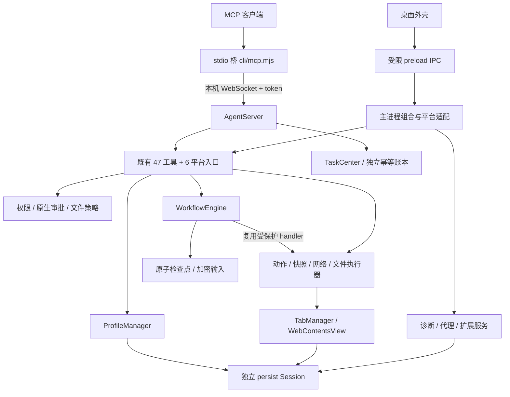

# 运行平台架构

v0.18.0 在原 Electron 浏览器中增加持久化身份与编排服务，继续使用现有页面执行器、MCP 桥、快照、标签队列和更新器，没有引入另一个浏览器工程。

## 进程职责

`src/main/index.ts` 组合应用窗口、服务、IPC、会话恢复和退出清理。网页放在 `WebContentsView`，不加载外壳 preload；快照与操作脚本由主进程注入。渲染层 `src/renderer/src/chrome.ts` 只通过 `src/preload/index.ts` 暴露的受限 IPC 管理本机界面。

`src/shared/tool-defs.mjs` 是工具名、参数 schema、描述和 MCP annotations 的唯一来源。原 handler 位于 `src/main/tools.ts`，新增管理入口由 `platform-tools.ts` 映射到主进程服务。`tool-validation.ts` 校验声明参数；桥与主进程读取同一份定义，不生成第二份工具语义。

## Profile 与 Session

`ProfileManager` 注册表版本为 1，保存稳定 ID、名称、描述、图标、颜色、默认项和待删除项。旧 `default` 映射 `persist:aa-main`，新身份映射 `persist:aa-profile-<id>`。会话恢复版本 3 增加 `profileId`，继续读取 v1/v2，旧记录归属默认身份。

Profile 上下文通过 `AsyncLocalStorage` 沿异步调用传递；客户端绑定、单次参数和工作流租约分别解决默认路由、显式选择和占用冲突。不要用可变全局变量代替调用上下文。历史、下载、扩展与证据目录按 Profile 路由；网站权限附着具体 Session。

关闭 Profile 会关闭其页面、取消下载、卸载运行扩展、刷新 Session 存储并关闭连接；Electron Session 仍可能保留数据库句柄和后台 Service Worker，只有退出应用才能完成进程资源释放。删除先清理 Session，再记录下次启动的目录清理。完整数据库复制必须离线。归档经认证加密，导入使用新 ID，不向现有目录解包。

普通工具通过 `ProfileManager.withUse` 登记在途使用，允许同一 Profile 内并发操作；工作流只有在这些操作全部结束后才能取得独占租约。可信工作流上下文内的工具复用该租约。停止和删除拒绝在途使用，生命周期变更期间拒绝新的自动化操作。

## 任务与工作流

`TaskCenter` 版本 2 继续记录每次工具调用、来源、浏览器实例、标签、步骤进度和副作用；最多 200 条任务，步骤和状态历史分别限量。`AgentServer` 维护活动调用的 AbortController、客户端所有权和进度，断开时不遗留可执行的旧调用。

`WorkflowEngine` 是单独的版本 1 持久化执行器，最多 100 个流程、每个 80 步。步骤有稳定 ID、依赖、参数摘要、结果元数据、重试次数和前后检查条件。实际参数加密或不落盘；输出正文不写审计。运行时借用 Profile 租约，依次调用既有受保护工具，完成后释放。

`BrowserPlatform` 将持久化所有者映射到当前在线的 MCP 连接；断开时删除映射并暂停任务。流程核验和执行不能使用失效连接，也不能静默退回 UI 身份。原生桌面接管审批只授予该工作流本次调度的 UI 上下文，执行结束后清除。

执行前先保存 intent，之后才派发工具。重启把执行中状态转为 interrupted；只读步骤可显式恢复并有界重试，写操作不自动重放。定向 retry 仍需当前页面校验和可信人工审批。调度只支持应用运行期间的一次性时刻，不提供 OS 唤醒、cron 或分布式任务。

旧桥的自动重连仅重发 readOnly 且 idempotent 的调用，写操作直接提示核验页面。`IdempotencyLedger` 独立保存高危请求受理记录，不能因任务裁剪而丢失防重保护。

## 专业能力

`NetworkEnvironmentManager` 对每个 Profile 串行应用 `Session.setProxy`，关闭旧连接并清理认证缓存，保存失败时回滚。按网站代理采用经过校验的主机规则生成 PAC；不执行用户任意 PAC 脚本。连通性测试使用对应 Session，请求出口 IP 需要明确操作；DNS 诊断是本机解析结果。

`VisualOperationManager` 保存有期限的截图、文档代际、视口、滚动、缩放和像素摘要。操作前和审批后重新校验；过期坐标不复用。视觉模型/OCR 不在本项目中，Agent 根据截图判断目标，DOM/ref 仍是首选。

`collectBrowserDiagnostics` 聚合真实进程指标、页面恢复信息、已捕获请求失败、控制台错误、Profile、MCP 和工作流状态。修复只接受明确的有限动作，不自行清理登录数据。扩展管理沿用 Electron 本地解压加载，增加 Profile 分配、权限与状态、禁用和本地版本检查。

## 兼容与验证

新增参数为可选 `profileId`；原有 47 个工具名称和旧参数继续保留。工具总量是 53，数量由 `check-tools.mjs` 在定义、handler、annotations 与 README 之间校验。新增数据都有版本标识，无法安全读取的存储保留原件并阻止相关危险操作。

验证分别覆盖生产模块单元、真实回环 WS、Electron 页面集成、原生外壳与安装包。编译、模拟页面测试和真实网站账号验收属于不同证据，发布报告必须分别记录，不能以一个通过推断另一个通过。
