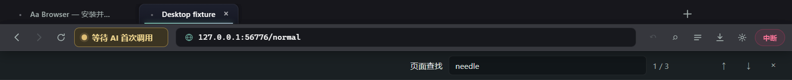

# Aa Browser 本地进化升级报告

日期：2026-11-13。基线：`main` / `e6e1226` / 应用版本 `0.0.2`。

后续复查已补充配置/历史持久化与更新状态修复，详见 [BUG_RECHECK-2026-11-13.md](./BUG_RECHECK-2026-11-13.md)。下方测试和打包记录保留为首轮升级的历史证据；当前源码验证结果以复查报告为准，首轮目录包不包含后续修复。

本轮完成项目识别、相关开源代码研究、重点路径审计、实现、原生桌面回归、MCP 冒烟验证与文档同步。改动处于未发布状态，未提交、未推送、未创建 Release、未部署。开始时已有未跟踪的 `.evolution/`，本轮保持原样。

## 项目认知与功能地图

定位是面向人类与 AI Agent 的 Windows Chromium 桌面浏览器。技术栈为 Electron 45、TypeScript、electron-vite、原生 DOM/CSS、WebSocket 和 electron-updater。仓库采用 MIT 许可证；没有独立业务服务端或关系数据库。

| 路径 | 已有职责与本轮检查范围 |
|---|---|
| `src/main/index.ts` | BaseWindow、WebContentsView 布局、外壳 IPC、快捷键、启动/退出生命周期；重点审查与修改 |
| `src/main/tabs.ts` | 普通共享会话、逐标签隔离会话、导航白名单、弹窗、标签生命周期；重点审查与修改 |
| `src/main/sessions.ts` | 权限请求/检查、隔离分区清理；重点审查与修改 |
| `src/main/tools.ts`、`actions.ts` | 33 个 Agent 工具、真实输入、Cookie/Storage/文件等操作；读取接口及相关调用路径，使用既有回归验证 |
| `src/main/agent-server.ts` | 127.0.0.1 服务、令牌鉴权、请求取消、客户端连接验证；读取启动和协议处理 |
| `src/main/network.ts`、`dialogs.ts` | CDP 抓包/拦截、对话框守卫；检查初始化、共享 debugger 与释放路径 |
| `src/main/history.ts`、`settings.ts` | JSON 历史及设置持久化；检查读写与调用者，未迁移现有数据 |
| `src/main/downloads.ts` | Electron session 下载跟踪、进度与文件操作；检查事件和外壳入口 |
| `src/main/clients.ts`、`cli/` | MCP 客户端接入、stdio 桥、安装；运行既有配置验证与工具契约检查 |
| `src/main/updater.ts` | 正式安装版更新检查/下载/安装；本轮未修改更新流程 |
| `src/preload/index.ts`、`src/shared/types.ts` | 外壳专用 IPC 能力及类型契约；随新增功能同步扩展 |
| `src/renderer/` | 标签、地址栏、新标签接入引导、设置、审批、下载和活动记录；检查并修复交互/浮层 |
| `src/snapshot/` | DOM 可访问性树、稳定 ref 与增量快照；本轮未重写，使用 MCP 冒烟覆盖 |
| `.github/workflows/ci.yml` | Windows 检查、构建、冒烟及标签发布工作流；增加桌面回归步骤，未触发远端运行 |

启动：`npm run dev`；生产资源构建：`npm run build`；本地预览：`npm start`。打包配置在 `electron-builder.yml`。已有快照、MCP、网络抓包、客户端配置和更新逻辑是真实实现，没有重复开发。

这是一轮重点路径审计与升级，不等于逐行完成整个仓库的安全审计。

## 开源项目研究

以下项目均通过 GitHub 当前仓库元数据、目录树、对应源码和许可证文件核查。检查时间为本报告日期；维护时间仅表示当时看到的最近推送，不代表质量评分。本轮没有复制、移植或新增依赖于这些项目的代码。

| 项目 | 维护状态（观察值）与许可证 | 实际阅读的源码/文档 | 借鉴结果 |
|---|---|---|---|
| [Min](https://github.com/minbrowser/min) | 非归档；最近推送 2026-11-08；Apache-2.0 | [sessionRestore.js](https://github.com/minbrowser/min/blob/master/js/sessionRestore.js) 排除 private 标签、原子保存；[permissionManager.js](https://github.com/minbrowser/min/blob/master/main/permissionManager.js) 对权限分别决策；`LICENSE.txt` | 恢复记录排除隔离标签；剪贴板读取与复制写入区别处理。原子存储作为后续工作，未宣称完成 |
| [Vieb](https://github.com/Jelmerro/Vieb) | 非归档；最近推送 2026-11-13；GPL-3.0 | [app/renderer/tabs.js](https://github.com/Jelmerro/Vieb/blob/master/app/renderer/tabs.js) 的 recentlyClosed、container 与恢复数据定义；`LICENSE` | 补齐最近关闭标签的键盘入口；结合本项目定义只保留短期普通 URL。GPL 源码不移植到本 MIT 仓库 |
| [electron-browser-shell](https://github.com/samuelmaddock/electron-browser-shell) | 非归档；最近推送 2026-10-25；MIT | [packages/shell/browser/tabs.js](https://github.com/samuelmaddock/electron-browser-shell/blob/master/packages/shell/browser/tabs.js) 的布局、移除视图、销毁 WebContents 与监听释放；`LICENSE` | 修复浮层实际边界；明确 BaseWindow 子视图清理责任 |
| [Playwright MCP](https://github.com/microsoft/playwright-mcp) | 非归档；最近推送 2026-11-13；Apache-2.0 | [README](https://github.com/microsoft/playwright-mcp/blob/main/README.md) 的结构化快照接口；[tests/core.spec.ts](https://github.com/microsoft/playwright-mcp/blob/main/tests/core.spec.ts) 的真实测试服务器与工具响应断言；`LICENSE` | 保留本项目已有结构化快照；增加本地服务器、实际页面和工具协议的回归，而非再造快照功能 |
| [browser-use](https://github.com/browser-use/browser-use) | 非归档；最近推送 2026-11-12；MIT | [browser/browser.py](https://github.com/browser-use/browser-use/blob/main/browser_use/browser/browser.py) 的浏览器模式、临时 profile 和生命周期说明；[代码结构说明](https://github.com/browser-use/browser-use/blob/main/browser_use/README.md)；`LICENSE` | 将 profile、历史、设置、下载、发现文件全部纳入独立测试环境；查找状态独立成模块 |

Electron API 按官方 [webContents 文档](https://www.electronjs.org/docs/latest/api/web-contents#contentsfindinpagetext-options)、[session 权限文档](https://www.electronjs.org/docs/latest/api/session#sessetpermissionrequesthandlerhandler) 和 [View 文档](https://www.electronjs.org/docs/latest/api/view) 核对。

### 差距转化

| 维度 | 原有实现 | 参考实践与差距 | 本轮成果 |
|---|---|---|---|
| 核心功能 | Agent 能查找页面，人类缺少页面查找条；误关标签只能手动重开 | 成熟浏览器具备查找与短期恢复 | 原生查找、匹配计数/方向、最近关闭普通标签恢复 |
| UI | CSS 面板存在，但外壳原生高度一般仅 84px | 网页 CSS 无法越过原生视图边界 | 同步实际面板底边，关闭归还网页区域，保持既有石墨/海玻璃色系 |
| 体验 | 快捷键处理只挂在外壳 | 页面获得焦点后也需响应浏览器操作 | 每个页面视图安装快捷键；工具栏亦有可发现入口 |
| 架构 | CDP 与多个视图共享生命周期 | 创建、关闭、退出需要明确资源归属 | 独立 PageFinder；请求 ID 绑定；销毁检查、调试器释放与外壳清理 |
| 自动化 | 已有完整 MCP 冒烟，但历史/设置未隔离 | 测试环境不能影响日常 profile 之外的全局 JSON | 修复冒烟隔离范围，新增真实 Electron 桌面回归及 CI 步骤 |
| 扩展 | 33 个工具已有三方契约检查 | 新增 UI 能力不必增添重复 MCP 工具 | 保持工具数量和协议兼容，通过外壳专用 IPC 扩展 |

## 优先级、收益与实施结果

| 优先级 | 问题/升级 | 用户收益 | 难度/风险 | 结果 |
|---|---|---|---|---|
| P0 | 隔离标签写入全局历史 | 私有浏览 URL 不出现在普通历史建议 | 低；不修改旧历史 | 已修复普通导航和 SPA 导航 |
| P0 | 隔离页面 window.open/右键新标签回到默认分区 | 防止私有页面后续浏览意外使用普通登录态 | 低；沿用每标签独立分区定义 | 两个入口显式保留隔离标记 |
| P0 | 网页脚本可请求读取系统剪贴板 | 防止页面主动读取外部剪贴板内容 | 低；主动粘贴继续使用用户操作路径 | 同步权限检查与异步请求均拒绝读取；普通写入保留 |
| P1 | 网页聚焦后快捷键无效 | Ctrl+T/W/L/F 等可在网页中工作 | 低；复用同一个快捷键处理函数 | 每个页面注册 |
| P1 | 下载/记录/历史建议裁切 | 已有入口变为可见、可点击面板 | 中；涉及原生视图布局 | 实际 DOM 尺寸同步到主进程，关闭后还原 |
| P1 | 页面查找缺少人类入口 | 无需 Agent 即可查找并逐个定位 | 中；异步结果可能串页 | 独立模块、请求 ID 与当前标签校验；切页/整页导航关闭 |
| P1 | 缺少误关恢复 | 快速找回本次运行最近关闭的普通页面 | 低；需防隐私泄漏和白名单绕过 | 内存 LIFO 最多 20 个 URL，恢复时重查白名单 |
| P1 | iframe 内导航可覆盖主标签地址 | 地址栏和历史不会被子框架 SPA 路由污染 | 低 | 只处理主框架导航 |
| P1 | 测试未隔离历史/设置 | 测试不再污染日常浏览记录/设置 | 低 | 两套测试均使用仓库内独立目录 |
| P2 | 窗口与标签关闭时仍有 CDP/视图资源 | 降低关闭后的悬挂任务和资源驻留 | 中 | 释放调试通道；终止已移除标签的初始化后续步骤；显式关闭外壳 WebContents |
| P2 | 异步历史建议过期结果 | 快速编辑/清空地址栏不再显示旧查询建议 | 低 | 对比当前输入，清空时取消待执行定时器 |
| P2 | 键盘焦点与减少动画偏好 | 控件焦点可见，尊重系统减少动效设置 | 低 | 补充 focus-visible 和 reduced-motion |

没有新增 AI 云服务、数据库、插件框架或运行时依赖。现有持久化格式未变化，无数据库迁移；旧历史中已有的隔离 URL 未自动删除。

## 使用与边界

- `Ctrl+F` 或工具栏查找按钮打开原生页面查找；输入后显示匹配序号与总数；`Enter` / `Shift+Enter` 或上下按钮切换；`Esc` 关闭。
- `Ctrl+Shift+T` 或恢复按钮重开最近关闭的普通 URL。最多保留 20 条，只在当前进程中存在；不恢复表单内容、滚动位置、页面返回栈或上次退出前的窗口。
- 隔离标签不会进入历史或恢复栈。弹出/右键子标签继续使用独立的隔离分区，不继承普通 Cookie，也不会共享父隔离标签的 Cookie；这沿用现有“每标签隔离”语义。
- 浮层打开时，原生外壳覆盖包含该浮层的顶部矩形区域；点击外部区域或关闭按钮可收起。该实现没有引入单独的原生弹窗窗口。
- 网页权限策略仍是敏感能力拒绝列表，不是完整的按站点授权管理器。

真实 Electron 测试页面的外壳截图（不包含用户页面）：

界面沿用既有颜色与紧凑桌面布局，没有替换框架、全量换肤或增加装饰页面。

## 重要文件修改清单

| 文件 | 原因 |
|---|---|
| `src/main/page-finder.ts`（新增） | 原生查找状态、方向、请求 ID、标签/导航生命周期 |
| `src/main/tabs.ts` | 最近关闭栈、隔离历史、弹窗继承、主框架判断、关闭后的初始化检查/CDP 释放 |
| `src/main/index.ts` | 原生布局、快捷键覆盖网页、新 IPC、状态初始化一致性、上下文菜单/退出清理 |
| `src/main/sessions.ts` | 拒绝网页读取剪贴板及近似定位权限 |
| `src/preload/index.ts`、`src/shared/types.ts` | 新增外壳 IPC 与 FindState 契约 |
| `src/renderer/index.html`、`src/renderer/src/chrome.ts` | 查找条、恢复按钮、浮层高度同步、关闭交互、过期建议处理 |
| `src/renderer/src/style.css` | 查找工具带、透明外壳下层、审批/浮层定位、焦点与减少动效 |
| `scripts/test-desktop.mjs`（新增） | 实际 Electron、WebContentsView、真实输入与本地页面回归 |
| `scripts/smoke.mjs` | 补齐历史/设置隔离、工作目录内测试数据、移除日常下载目录清理 |
| `package.json`、`.github/workflows/ci.yml` | 桌面测试命令及 Windows CI 步骤 |
| `.gitignore` | 忽略 `.local-verification/`，保留用户已有 `.evolution/` |
| `README.md`、`CONTRIBUTING.md`、`docs/releases/release-notes.md` | 未发布功能、测试方法、异常日志位置与验证边界 |
| `docs/screenshots/page-find-toolbar.png`（新增） | 实际运行的外壳截图 |

没有删除业务源文件或用户数据文件。

## 验证记录

| 状态 | 命令/检查 | 证据与边界 |
|---|---|---|
| PASS | `npm run check` | TypeScript 严格检查；主进程/桥/README 的 33 个工具定义一致 |
| PASS | `npm run validate:codex` | 既有独立配置验证：保留无关配置、备份、幂等；不等同于在真实客户端中接通 |
| PASS | `npm run validate:workbuddy` | 既有 Connector 元数据与独立配置行为验证；不等同于真实 WorkBuddy 工具加载 |
| PASS | `npm run build` | main/preload/renderer 和 MCP bridge 构建成功；应用仍为 0.0.2，未虚构新版本号 |
| PASS | `npm run test:desktop` | 15 项真实桌面断言，进程退出码 0；包括查找计数/方向/空状态、iframe 导航、浮层原生边界、网页 Ctrl+L/T/W、快捷键恢复、切页、剪贴板拒绝、隔离历史/SPA/弹窗/右键、恢复白名单和外壳 console 错误检查 |
| PASS | `npm run smoke` | 91 项断言通过、0 失败，脚本退出码 0；覆盖握手、结构化快照/增量/稳定 ref、真实点击与输入、表单、对话框、网络拦截、Cookie/Storage、上传/下载/PDF、隔离和分区回收。脚本主动终止自己的测试 Electron 子进程，不以该子进程的强制终止码判断正常退出；正常退出由桌面测试另行验证 |
| PASS | `npx electron-builder --win --dir --publish never --config.electronDist=node_modules/electron/dist --config.directories.output=.local-verification/package-final` | 使用已安装的 Electron 对最终构建生成 Windows x64 目录包，退出码 0；明确跳过代码签名，没有运行安装器。默认下载方式的首次目录打包也通过，最后一次默认方式等待未完成，已停止该打包进程并改用本地分发目录 |
| PASS | `git diff --check` | 无新增空白错误；Git 的 LF/CRLF 转换提示不属于检查失败 |
| PARTIAL | 视觉检查 | 已查看实际查找工具栏 PNG；未覆盖所有显示缩放、读屏、主题与长内容组合 |
| PARTIAL | 性能/资源 | 测试未发生操作超时；修正视图释放路径。未测长期内存、百标签负载、启动基准，不能宣称量化性能提升 |
| BLOCKED | 正式签名、旧版发现→下载→安装→重启新版 | 本轮没有发布/安装授权和真实更新试验；不能将本地构建称为更新端到端通过 |
| NOT APPLICABLE | 数据库迁移 | 未引入数据库或变更现有持久化结构 |

中间验证暴露了测试入口的 Electron ESM ready 等待、原生视图异步布局及 Windows 截图合成器依赖。现已修正测试启动/等待方式；默认回归不强制导出截图，可见桌面视觉 QA 可用 `AA_DESKTOP_SCREENSHOTS=1` 显式运行。早期截图或退出失败不作为通过证据，以上 PASS 以最终退出码为准。既有 console-message 事件签名会输出 Electron 弃用提示，尚不影响回归结果。

详细桌面断言留在 `.local-verification/desktop-*/result.json`，最近测试输出为 `.local-verification/desktop-output.log`、`smoke-output.log`、`package-final-output.log`。最终目录包在 `.local-verification/package-final/win-unpacked/`。这些测试产物不入库。CI 仅增加了配置，本轮没有远端运行结果。

## 后续工作与成熟度

建议按独立增量推进：

1. **P1 数据可靠性**：原子替换、异常数据校验、设置保存失败反馈与异常原文件备份已在后续复查修复；跨进程并发合并和历史写入失败的界面反馈仍待完善，详见复查报告。
2. **P1 发布验收**：正式签名、可复现实包安装/卸载、旧客户端升级和失败恢复；需专门的发行与安装环境。
3. **P2 下载管理**：暂停、恢复、取消、失败重试、下载记录跨重启保存。当前只跟踪、打开和定位文件。
4. **P2 导航与无障碍**：书签/历史管理、标签搜索、多审批长内容、不同 DPI 和读屏组合；完整审查每个浮层的焦点恢复。
5. **P2 安全策略**：逐权限、逐站点授权界面与实际来源校验；对所有 MCP 输入和本地服务开展专项安全审查。
6. **P3 扩展架构**：同一隔离上下文中的多标签协作、可选会话恢复、插件接口；先定义权限与隐私边界，避免直接引入庞大扩展框架。

以下为本次证据支持的保守评估，5 分表示达到可发布成熟度，不是全量产品质量认证；未验证的维度不硬打分。

| 维度 | 评估 | 实际依据与缺口 |
|---|---|---|
| 功能完整度 | 3/5 | 33 项 Agent 工具与核心浏览真实回归；已补查找/恢复，书签和下载控制仍缺 |
| UI/UX 成熟度 | 3/5 | 修复浮层、网页快捷键、空状态；只有 Windows 桌面和局部截图证据 |
| 代码质量 | 3/5 | 类型/契约/构建/回归通过，查找独立模块；主进程和外壳仍较集中 |
| 性能 | 未评分 | 没有可比较的资源/负载基准；不从构建成功推断性能 |
| 安全性 | 2/5 | 修复可验证的隔离/剪贴板问题，保留来源隔离；未做全量攻防与正式签名验收 |
| 稳定性 | 3/5 | 91 项 MCP + 15 项桌面回归与正常退出通过；缺长时间、跨版本、多机器证据 |
| 可维护性 | 3/5 | 现有技术栈、无新依赖、CI 增补与文档同步；持久化异常仍需改进 |
| 扩展性 | 3/5 | 共享类型与 MCP 契约保持兼容；暂不具备经过安全设计的插件平台 |

本轮交付是有测试支撑的本地升级，不声称软件已经完成全部商业化、发布或安全验收。
