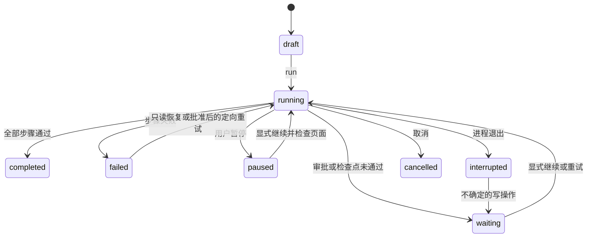

# 可恢复工作流

工作流把现有浏览器工具组成有依赖的持久化步骤。它负责执行、检查点、暂停与恢复；页面理解和下一步业务判断仍由 Agent 或编写模板的人完成，不内置自动规划模型。

## 快速开始

打开「设置 → 工作流」，选择简单模板、Profile 与目标网址后创建，再点击运行。复杂参数可以通过 MCP 的 `params` 或自定义 `steps` 提供。

```json
{"name":"browser_workflows","arguments":{"action":"create","name":"巡检首页","profileId":"default","templateId":"inspection","url":"https://example.com"}}
```

用返回的真实工作流 ID 运行，随后用 `get` 或 `list` 查看进度：

```json
{"name":"browser_workflows","arguments":{"action":"run","workflowId":"从创建结果返回的ID"}}
```

```json
{"name":"browser_workflows","arguments":{"action":"get","workflowId":"从创建结果返回的ID"}}
```

`browser_tasks` 继续记录每次 MCP 调用，不改变旧版 list/get/cancel/pause/resume 的语义。跨多个步骤的业务流程由 `browser_workflows` 管理。

## 自定义步骤

```json
{
  "name": "browser_workflows",
  "arguments": {
    "action": "create",
    "name": "打开并读取公开页面",
    "profileId": "default",
    "steps": [
      {"id":"open","name":"打开网站","tool":"browser_navigate","args":{"url":"https://example.com","snapshot":false}},
      {"id":"ready","name":"确认内容","tool":"browser_assert","args":{"checks":[{"kind":"selector","selector":"h1","op":"exists"}]},"dependsOn":["open"]},
      {"id":"read","name":"提取文本","tool":"browser_extract","args":{},"dependsOn":["ready"],"maxRetries":2,"checkpoint":{"before":{"urlContains":"example.com"}}}
    ]
  }
}
```

每个步骤保留 ID、名称、工具、输入摘要、依赖、状态、开始/结束时间、执行次数、检查点时间、结果元数据、错误和副作用状态。依赖顺序可与数组顺序不同；缺失依赖和循环会拒绝创建。最多 80 个步骤，每步输入最多 64 KiB，历史最多 100 个工作流，每个事件列表保留最近 200 项。

目前按拓扑顺序串行执行。没有结果变量插值、通用脚本语言或跨步骤事务；需要根据上一页结果动态决策时，由 Agent 读取真实页面后创建后续步骤。结果审计只保存内容类型、文本长度和成功状态，不将页面正文、截图 base64 或凭据写入工作流历史。需要文件结果时使用既有 PDF、HAR、截图或下载工具，并在对应 Profile 内管理文件。

`checkpoint.before` / `checkpoint.after` 支持 `urlContains`、`selector`、`text`。工作流使用当前真实页面检查条件；成功的工具响应本身不等于业务成功。提交订单、支付或发布后应提供能够证明预期状态的只读检查，不能仅凭页面变化宣告完成。

## 暂停、恢复与副作用



只读步骤的网络错误可以在配置次数内自动重试。写操作只执行一次；失败、崩溃或取消后若无法确认实际效果，标记 `uncertain`。程序启动不会自动恢复这些步骤。

恢复时保留已完成步骤，重新获取 Profile 租约并核验页面。中断的写步骤不会被 `resume` 直接执行。先手动或通过只读工具检查真实网站状态，确认确实需要再执行时调用 `retry` 指定步骤；浏览器会再次请求原生人工审批。`requiresApproval:false` 不是跳过高危审批的开关。

```json
{"name":"browser_workflows","arguments":{"action":"retry","workflowId":"工作流ID","stepId":"失败步骤ID"}}
```

取消不撤回已经提交的请求、点击、订单或文件操作。暂停会中止后续调度，并等待未结束的底层调用清理资源；旧调用尚未退出时不能重新运行同一工作流。人工接管期间不派发新的 AI 输入。

## 输入保护

支持操作系统安全存储时，实际步骤参数整体加密保存，界面只显示脱敏摘要。Linux 缺少安全密钥存储时不回退到明文：参数只在当前进程内存中保留，重启后步骤显示 `needsInput`，必须重新提供输入。

```json
{"name":"browser_workflows","arguments":{"action":"input","workflowId":"工作流ID","stepId":"步骤ID","input":{"ref":"从新快照获取的ref","text":"非敏感测试文本"}}}
```

已完成步骤不能改输入。页面导航或重启后旧 ref 可能失效，需要新快照确认。密码框仍由用户亲自填写，不应把密码作为工作流参数交给 Agent。

## 模板

| ID | 模板 | 参数与范围 |
| --- | --- | --- |
| `collect` | 网页数据采集 | `url`；导航后提取文本 |
| `multi-page` | 多页面提取 | `params.urls`；最多 10 个 URL，依次导航与提取 |
| `download` | 页面导出 PDF | `url`；复用 PDF 导出，不是任意下载链接解析器 |
| `inspection` | 网站巡检 | `url`；导航后读取页面状态 |
| `form` | 表单填写 | `url`、`params.fields`；填写仍走既有敏感输入与审批边界 |
| `page-test` | 页面断言 | `url`、`params.checks` |
| `compare` | 多网站对比采集 | `params.urls`；采集页面，业务比较结论由 Agent 判断 |
| `scheduled` | 定时网站巡检 | `url`、`params.scheduleAt`；未来 Unix 毫秒时间，应用运行时执行一次 |

定时任务不是操作系统唤醒服务，不会在应用退出期间执行。重新启动后尚未开始且到期的草稿可以被调度；已运行、中断或已完成任务不会因定时器重复执行。没有内置 cron 或循环调度语法。

同一个 MCP 桥会话可以在浏览器重启后查看自己的工作流。桥进程重新启动会生成新的客户端身份，旧工作流仍可在本机桌面管理，但新桥不能仅凭猜测 ID 获得旧会话所有权。

客户端断开时，其运行中或等待中的工作流暂停并释放资源。重新连接后需要重新取得对应 Profile 的原生访问审批。没有已连接所有者的工作流不能退回桌面身份自动执行；本机用户可以在桌面点击运行、继续或重试，先批准「Take over workflow」接管本次执行。接管不代替步骤审批，也不允许直接重放不确定的写入。

生产实现与测试：`src/main/workflows.ts`、`scripts/test-workflows.mjs`、`scripts/test-workflows-e2e.mjs`。E2E 使用两个真实 Chromium Session、两个 MCP 客户端、桌面审批以及主进程强制退出后的重启，核验检查点、暂停取消和副作用恢复。具体网站的外部副作用仍必须结合真实页面验收。
