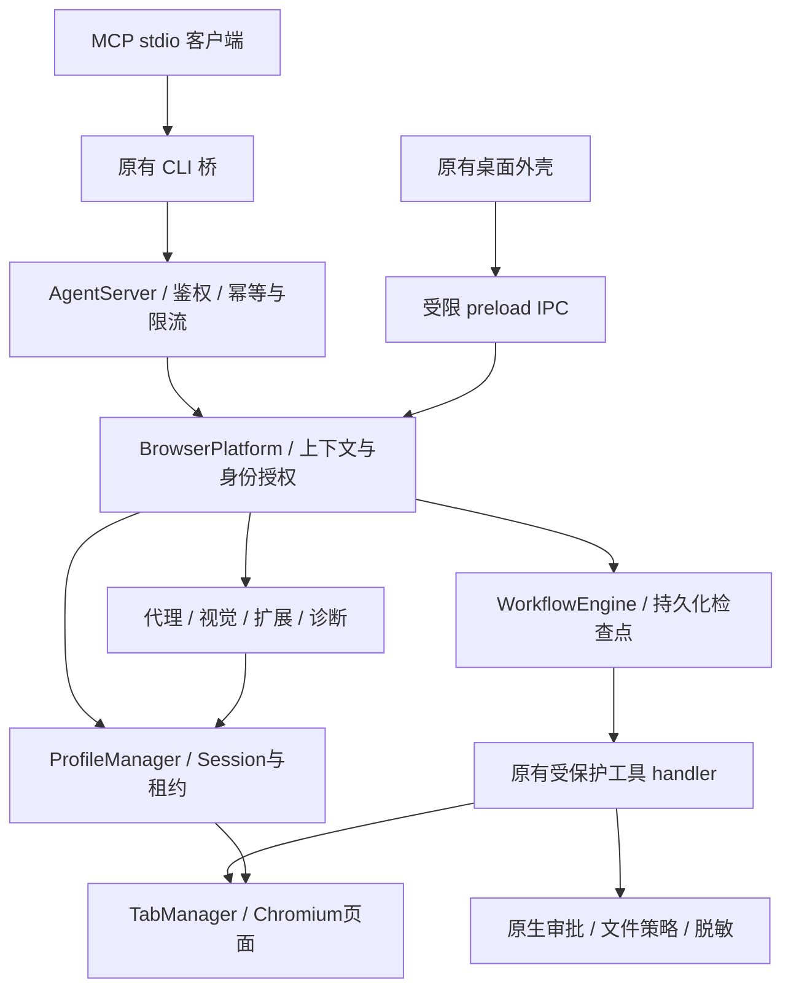

# aa-browser v0.18.0 交付报告

日期：2026-11-25。目标版本：`v0.18.0`。初始审查基线：`73d57a5` / `v0.17.0`。

本稿记录已经落地的代码、实际运行的测试与当前限制。**本稿不代表 v0.18.0 已发布，也不代表最终 CI、安装包或跨平台验收已经通过。** 发布提交、PR、CI、资产与旧版升级结果由主发布流程在 E 节补入。后续代码变更需要对应的最终复验，不能直接沿用较早构建的通过结论。

## A. 项目现状

### 原有架构与能力

项目继续使用 Electron 45、TypeScript、electron-vite 和原有 TypeScript 桌面渲染层。`src/main/index.ts` 组合 `BaseWindow`、浏览器外壳 `WebContentsView`、网页视图、IPC、MCP 服务、更新器及退出清理。只有浏览器外壳加载 `src/preload/index.ts`；网页无特权外壳桥和 Node 集成。

MCP 客户端通过 `cli/mcp.mjs` 的 stdio 桥连接 `src/main/agent-server.ts` 的随机 token 认证回环 WebSocket。`src/shared/tool-defs.mjs` 是工具 schema 与 annotations 的单一来源；原 47 个工具的 handler 继续位于 `src/main/tools.ts`。

原有成熟能力包括 DOM/ref、Accessibility 快照与分页、frame/closed-shadow 操作、截图/PDF/多视口/像素比较、CDP 网络捕获/HAR/mock、上传下载、解压扩展、原生权限审批、单次 MCP 调用任务审计、取消与幂等账本、Renderer 恢复、自动更新与 Windows/Linux 发布流水线。这些能力继续复用，没有建立另一个浏览器工程。

### 审查结论与问题处理

完整的修改前清单、代码位置和验证方法见 [实施前审查](2026-11-25-v0.18.0-audit.md)。本次主要处理如下问题：

| 原有状态 | 发现的问题 | 本次处理及代码位置 |
| --- | --- | --- |
| 已有成熟执行器 | 多客户端标签所有权不能隔离登录态；普通标签共享 Session | 增加持久化 Profile 分区与异步上下文，保留旧 `persist:aa-main`；`profiles.ts`、`tabs.ts` |
| 单次调用任务记录 | 缺少可执行步骤图、依赖、检查点和恢复引擎 | 新增独立 `WorkflowEngine`，复用受保护工具 handler；`workflows.ts`、`platform.ts` |
| 全局服务与目录 | 历史、扩展、下载、证据、HAR、基线等可能混用身份 | 按 Profile 路由服务、文件目录和捕获状态；`history.ts`、`downloads.ts`、`extensions.ts`、`network.ts`、`evidence.ts`、`visual.ts`、`viewport.ts` |
| 审批可选 | 旧设置可能跳过高危操作审批；对象在审批期间可能变化 | 具体高危动作强制原生审批，批准后重新核验对象、页面和文档代际；`tools.ts`、`approvals.ts` |
| 敏感读取与日志 | Cookie/Storage 原值、请求内容和工具错误可能泄露凭据 | 默认脱敏，原值读取单独审批，审计仅保存必要元数据；`redaction.ts`、`tools.ts`、`network.ts`、`agent-server.ts` |
| 文件访问分散 | 任意上传路径、符号链接、跨身份目录、导出覆盖风险 | 增加统一文件策略及上传文件身份复核；`file-policy.ts`、`actions.ts` |
| 生命周期与并发 | 在途调用、Profile 关闭/删除、租约和资源释放有竞态 | 增加在途使用计数、排他租约、关闭/删除 busy 状态和身份安全释放；`profiles.ts` |
| 能力分散或缺失 | 没有 Profile 代理、截图版本绑定坐标操作和统一诊断中心 | 增加实际 Session 代理、视觉操作凭据和诊断服务；`network-environments.ts`、`visual-operations.ts`、`browser-diagnostics.ts` |
| 桌面管理不足 | 设置与任务面板缺少身份、工作流、网络和安全管理 | 通过原有外壳与受限 IPC 增加真实状态面板；`chrome.ts`、`index.html`、`style.css`、`platform-types.ts` |

审查还发现同步图像处理与大文件处理可能阻塞主进程。新增服务采用大小、条数与并发上限，但本次没有证明长期运行、多 Profile 满负载或大型 HAR 的完整性能目标均已达成。

初始审查曾检查 GitHub issue、安全告警、依赖 PR 与 npm audit；该快照只代表当时结果。最终修复、关闭 issue、安全复查与分支整理状态由发布流程补入，不能据此宣称发布时没有任何告警。

## B. 本次完成的功能

### Profile 与身份隔离

实现创建、编辑名称/描述/图标/颜色、默认项、启动/关闭、运行状态、客户端绑定、删除、加密导入导出及离线复制。新 Profile 使用独立 `persist:aa-profile-<id>`；Cookie、LocalStorage、IndexedDB、缓存、登录态、网站权限及代理认证由对应 Session 隔离。SessionStorage 保持 Chromium 的页面生命周期，不保证跨重启恢复。

历史、下载、HAR、截图、视觉基线、证据登记和扩展配置按 Profile 路由。相同文件名下载不会跨 Profile 覆盖；弹窗继承来源身份与 MCP 所有权；相同 URL 在不同 Profile 的会话恢复记录中分别保存。删除清理仅限目标身份，受控目录清理可延后至下次启动。

`stop` 会关闭页面、刷新存储并卸载运行中的扩展，但 **Electron Session 不能销毁**。关闭不保证立即释放全部数据库句柄、ServiceWorker 或全部内存。扩展启用配置保留，下一次启动恢复；不能把“已关闭”当成“本进程从未初始化过 Session”。

### 工作流与恢复

实现持久化依赖图、步骤输入摘要、开始结束时间、结果元数据、错误、尝试次数、前后检查点和审批状态。提供运行、暂停、继续、取消、指定步骤重试、参数重录和八种现有工具模板。运行时持有 Profile 租约，其他冲突调用返回 `PROFILE_BUSY`。

终态流程可由所有者经原生确认后删除，释放最多 100 条历史的容量；运行中或清理未完成的流程不能删除。删除只清理流程与保存输入，保留导出文件和已发生的网站操作。初始化中关闭的标签不会在迟到 Promise 完成后再导航，内部 `about:blank` 不覆盖目标地址或提前宣布加载完成。

派发前原子保存 intent；异常退出后执行中的写入标记为 `uncertain`。已完成步骤不会重放，普通 `resume` 不执行不确定写入；定向 `retry` 仍须重新核验页面并通过原生人工审批。审批之后再次检查页面，避免用户考虑期间页面发生变化。取消不能撤回已经发生的外部副作用。

MCP 所有者断开后暂停并撤销连接映射。恢复必须重新取得任务真实 Profile 的访问授权，不能使用后来切换的默认 Profile，也不能把失效的数字客户端 ID 当成所有权。失联流程需要桌面用户批准本次调度的接管；接管不代替步骤审批。身份审批和执行过程均接收取消信号。

工作流输入有安全 OS 存储时整体加密；不可恢复时标记 `needsInput`，要求重新输入，不回退明文。结果持久化只包含成功状态、内容类型、文本长度和图片数量，不保存页面正文或截图 base64。

### 安全、文件与 MCP 边界

新增七级范围权限、Profile/client/task 关联、期限、撤销、单次高危/敏感 grant 与审计。**范围 grant 不能识别具体 DOM 对象或脚本，不能替代具体高危或敏感动作的逐次原生审批。** `approved:true`、`once:false`、`requiresApproval:false` 及旧审批设置均不能绕过该边界。

Cookie/Storage 默认隐藏敏感值；原值读取、凭据与敏感网络内容按明确入口审批。DOM/ref/frame、按键、选择、拖拽和脚本执行结合对象与上下文检查风险，批准后复核对象指纹、文档与 URL。日志和审计不记录工具结果正文，常见 Token、认证头、密码、私钥与敏感 URL 参数做脱敏；这不等于通用 DLP，图片、任意正文和外部文件仍可能包含秘密。

统一文件策略覆盖上传、PDF、HAR、截图、视觉基线和归档。拒绝跨 Profile 私有目录、路径穿越、符号链接/junction、Windows 设备路径、NTFS ADS 与保留文件名；外部访问需要明确审批；导出默认不覆盖；上传验证已打开文件的实际身份、大小及取消状态。

MCP 服务增加入站大小与并发边界，剥离客户端伪造的 `__aa*` 元数据，异常日志不回显原始 JSON。既有幂等账本继续独立于任务历史保留，阻止旧写请求因审计裁剪或重启而重新受理。

### 网络、视觉、扩展与诊断

代理配置实际应用于对应 Electron Session，支持 HTTP/HTTPS/SOCKS5、启停、按主机规则生成 PAC、连通性与路由检查、DNS/延迟诊断和明确触发的出口 IP 检查。切换关闭旧连接并清理认证缓存；密码只使用 OS 安全存储，不能保存时拒绝。没有把“保存了表单”当成代理已经生效。

截图返回有有效期的 `captureId`，绑定页面、视口、缩放、滚动和像素。坐标点击、拖拽、裁剪使用 CSS 视口坐标，操作前与批准后重新验证；记录前后截图与坐标。**没有内置 OCR、图像语义搜索或自动按钮识别模型**；目标坐标仍由 Agent 根据截图判断，DOM/ref 仍是首选。`visualChanged` 只表示像素变化，不证明业务成功。

扩展管理继续使用本地解压扩展，增加 Profile 独立配置、启停、版本/权限/来源/错误状态和本地版本变化检查。没有扩展商店、远程自动更新或任意外部扩展目录打包。

诊断中心汇总真实 Electron 进程指标、Profile、MCP、工作流、页面、已捕获网络/Console 错误、下载与扩展状态。修复使用有限的明确动作；不会默认删除 Cookie、Storage、登录态或重要文件。刷新仍可能丢失未提交表单，重新连接仍可能中断在途请求。

### 桌面与文档

沿用原窗口、标签与导航架构，增加当前 Profile 选择、工作流步骤/进度/日志、网络环境、安全审批与诊断面板，并保留原工具功能。界面状态通过真实 IPC 获取，无假任务、假资源指标或装饰性按钮。

新增 [Profile 指南](../PROFILES.md)、[工作流指南](../WORKFLOWS.md)、[权限安全模型](../SECURITY_MODEL.md)、[架构说明](../ARCHITECTURE.md)、[MCP 工具示例](../MCP_TOOLS.md)，更新 README、CONTRIBUTING 与连接指南。实际软件截图已在最终本地 UI 构建重抓，保存于 `docs/screenshots/v0.18.0-profiles.png`、`v0.18.0-profiles-minimum.png`、`v0.18.0-workflows.png` 和 `v0.18.0-extensions.png`；已人工检查无空白、遮挡或横向溢出。

## C. 架构变化

| 结构或边界 | 实现 |
| --- | --- |
| Profile 注册表 | 版本 1，稳定 ID、元数据、默认项、待删除项；旧 `default` 分区和数据路径保留 |
| 会话记录 | 版本 3 增加 `profileId`，读取旧 v1/v2；URL 去重包含身份，标签 ID 延续 |
| 工作流存储 | 版本 1，最多 100 流程、每流程 80 步、每步输入 64 KiB、每流程 200 事件、存储上限 16 MiB |
| 工作流执行 | 依赖拓扑顺序串行，步骤调用既有受保护 handler，Profile 在途计数与排他租约防止冲突 |
| 身份传播 | `AsyncLocalStorage` 传播 Profile/客户端/租约上下文，显式 `profileId` 优先于客户端绑定，再回退默认项 |
| 所有者恢复 | 稳定 MCP 会话与在线连接映射；无 UUID 的连接加入本次运行标识，失联流程不能静默使用桌面权限 |
| 权限安全 | 范围/期限/一次性授权记录与具体动作原生审批分离；实际目标 Profile 在检查点之前完成授权 |
| 文件安全 | Profile 管理目录、已批准外部路径、已打开文件身份与排他写入统一约束 |
| 原子持久化 | 保留既有 `atomic-json.ts`，数据损坏保留原件并阻止危险恢复，不将坏数据当成空历史 |
| 资源清理 | 取消信号、在途任务、租约、监听器、代理连接和扩展生命周期配对清理；不宣称 Electron Session 可被销毁 |

MCP 总量由 47 增至 53，新增 `browser_profiles`、`browser_workflows`、`browser_network`、`browser_visual`、`browser_permissions`、`browser_diagnostics` 六个管理入口。原 47 个工具保留名称与原参数；增加可选 `profileId`，未传新参数的旧调用继续有效。`browser_tasks resume` 仍只恢复接收调用，不改变为重放旧调用。安全策略加强后，旧客户端可能遇到更多明确人工审批或文件策略拒绝，这属于已公开的安全迁移行为。

## D. 测试结果

### 已有执行证据

以下为本稿已经收到或读取的实际通过结果；计数是各脚本自己的检查组数，不合并成一个虚构的总测试数。`.local-verification` 为当前机器的隔离证据目录，不作为仓库中的发行资产。

| 范围 | 结果与命令 | 证据与边界 |
| --- | --- | --- |
| 工作流单元 | `node scripts/test-workflows.mjs`：10 组 PASS | 依赖/所有权/有界重试、加密与重录、崩溃检查点、副作用审批、页面变化、损坏存储、八模板、单次调度、身份审批取消，以及安全删除和容量回收 |
| 任务持久化 | `node scripts/test-task-center.mjs`：PASS | 生命周期、恢复状态边、损坏/不兼容数据保留 |
| Profile 单元 | `test-profiles.mjs`：13/13 PASS | 真实文件归档回环、路径/Windows alias/大小写冲突、符号链接、扩展分区、在途使用与租约竞态；对应生命周期行为已再次运行真实集成 |
| 服务与安全单元 | `test:platform-security` 9/9、`test:approval-parity` 14/14、`test:cancel-side-effects` 28/28、`test:tab-queue` 19/19 PASS | 默认脱敏、范围 grant 不能豁免动作审批、输入与路径、取消及排队边界；命令结果由对应验证流程记录 |
| 原有基础回归 | `test:stores` 13/13、`test:session-permissions` 12/12、`test:main-diagnostics` 160/160、扩展/Agent 取消/证据导出 PASS | 保留原持久化、权限、诊断和执行边界；最终全量结果以同一提交 CI 为准 |
| Profile 真实集成 | `node scripts/test-profiles-e2e.mjs`：10 组 PASS | `.local-verification/profiles-e2e-DYynR9/result.json`；真实 Session、Cookie/Local/Session/IndexedDB、双客户端、弹窗、扩展、上传下载、代理、Renderer 崩溃、同 URL 恢复，以及停止/重启保留登录并恢复启用扩展 |
| 工作流真实集成 | `node scripts/test-workflows-e2e.mjs`：17 组 PASS，退出码 0 | `.local-verification/workflow-e2e-OG4Qmy/result.json`；两个真实 Electron 进程、双 Profile/客户端并发、租约、审批、暂停/取消/断连、客户端暂停隔离、全局中断/接管阻止定时草稿、父进程强制终止及定向重试 |
| 网络与视觉真实集成 | `node scripts/test-platform-services-e2e.mjs`：6 组 PASS | `.local-verification/platform-e2e-1795589587098-42652/result.json`；真实 Chromium HTTP/PAC 路由与切换，真实 Canvas 像素变化与过期坐标拒绝 |
| 桌面平台 UI | `test:platform-ui`：16 组 PASS | `.local-verification/platform-ui-1795592348646-29472/result.json`；真实表单/审批/Profile/工作流/网络/安全/诊断/扩展、终态流程删除拒绝和批准、Profile 路由、最小窗口与 Console 检查；四张截图已重抓 |
| 设置与 UI/UX | `test:settings-safety`：27 组；`test:ui-ux`：102/102 PASS | `.local-verification/settings-safety-CB0uie/result.json`、`.local-verification/ui-ux-after-1795590938364-37484`；最终本地统一构建，独立设置夹具补齐真实运行同样的反遮挡开关后通过，未降低断言 |
| 原有桌面真实回归 | smoke 19 章节、desktop 58/58、extensions 两次真实启动、background 11 组 PASS | `.local-verification/desktop-1795590474144-30440/result.json`、`extensions-e2e-1795590505662-57424`、`background-y6FkEy/result.json`；smoke 退出码 0、无单独 JSON。Agent cancellation/WebSocket/metadata、approval-runtime 14/14 再次通过 |
| Renderer 故障与动作边界 | `test:renderer-crash`：13 PASS、1 SKIP，退出码 0 | `.local-verification/renderer-crash-mxvkhP/result.json`；真实崩溃/OS kill、兄弟页面隔离、在途记录、恢复中再次崩溃及上限、控件状态/focus trap/moving/旧 ref；40 秒真实主线程 hang 未触发 `unresponsive`，该项跳过 |
| 静态与构建 | 最终本地 `npm run check`、`npm run build`、desktop 58/58 均通过，退出码 0 | `.local-verification/check-final6.log`、`build-final6.log`、`desktop-1795592260850-56256/result.json`；修复在途初始化关闭导致的原生退出失败，保持原生窗口关闭与会话持久化断言；构建成功不等于安装包、签名或跨平台验收成功 |

真实登录隔离测试使用本机 HTTP 夹具与模拟账号；没有支付、发布或真实第三方账号的验收结论。工作流测试让服务端已收到一次 POST、响应仍悬挂时由父进程终止应用。重启、普通恢复、拒绝接管、审批期间修改 DOM 和拒绝重试都没有产生第二次 POST；只有再次批准指定步骤后计数由 1 变为 2，先前完成步骤仍只执行一次。

新增三组暂停回归还验证：客户端 A 暂停会中止已接受工作流的在途等待并释放租约，客户端 B 不受影响；桌面不能替在线但暂停的所有者运行流程。全局中断和 MCP 人工接管均暂停在途执行与定时草稿；等待定时到期以及恢复客户端/交还控制后，步骤执行次数保持不变，只有显式工作流继续才执行。

代理验收证明对应 Chromium Session 的真实路由，不证明中国大陆吞吐、任意企业代理兼容性或所有 SOCKS/认证组合。视觉测试证明真实 Canvas 输入和像素凭据校验，不证明 OCR 或语义识别。

### 最终验证结论与剩余限制

| 项目 | 本稿状态 |
| --- | --- |
| 最终全部代码的静态与原有完整回归 | 通过：最终提交 `728cb7c` 的标签 CI 静态检查、单元套件、Windows x64 与 Linux x86_64 桌面套件全部成功（run `45573173303`）。 |
| Renderer 卡死事件恢复 | Windows Electron 45 运行时的 40 秒真实主线程 hang 未触发 `unresponsive`，专用回归明确 SKIP；不能将真实 crash/OS kill 的通过结果当作该项通过 |
| Windows x64 NSIS 安装/卸载与打包 MCP | 通过：标签 CI 的 Windows x64 作业完成 NSIS 安装、打包 MCP 冒烟与静默卸载。 |
| Linux x86_64 AppImage 与桌面 | 通过：标签 CI 的 Ubuntu 24.04 CI/Xvfb/Openbox 作业完成 AppImage 构建、启动与 MCP 桥连接；不代表所有发行版。 |
| 旧版至 v0.18.0 的真实更新提示与安装 | 更新发现通过：真实 v0.17.0 客户端发现 v0.18.0，提示与操作按钮可见，未下载安装包；完整下载安装未执行，不能宣称真实升级安装完成。 |
| 长时间多 Profile/大 HAR/高频截图资源基准 | 未完成全面压力与性能基准；不承诺已消除全部内存泄漏或主进程阻塞 |
| Windows Authenticode | 无签名证书完成证据；当前应按未签名安装包处理 |

## E. 发布情况与迁移

### 发布记录

本次源码目标为 `0.18.0`，已由标签 CI 构建并发布为不可变 GitHub Release。构建配置保留 `appId: com.aa.browser`、GitHub provider 与原有数据位置，声明平台为 Windows x64 NSIS、Linux x86_64 AppImage。没有新增 macOS 支持结论。

| 发布字段 | 最终状态 |
| --- | --- |
| 最终提交 / PR | `728cb7c0183b702d4c2f124077a6dcaa30592672`；PR [#28](https://github.com/yuchen0x1/aa-browser/pull/28) 于 `2026-11-25 08:03:36 UTC` 合并。 |
| main 合并与分支处理 | 已合并；远端只保留 `main`，7 个被覆盖的 Dependabot PR 已关闭，`release/v0.15.0` 已删除；未删除未确认的用户工作。 |
| issue 修复、回复和关闭 | 发布前开放 issue 为 0；没有需要修复或关闭的 issue。 |
| 安全告警 / 依赖审计 | Dependabot 与 CodeQL 开放告警均为 0；`npm audit --audit-level=high` 为 0 漏洞；依赖审查通过。 |
| main / tag CI | 主线 CI `45573022544`、CodeQL `45573022534`、标签 CI `45573173303` 均成功。 |
| `v0.18.0` 标签 / Release | 标签指向 `728cb7c`；Release 于 `2026-11-25 08:12:38 UTC` 发布为 Latest、非草稿、非预发布、不可变。 |
| Windows / Linux 资产 | 7 项资产：NSIS 安装包与 blockmap、AppImage、`latest.yml`、`latest-linux.yml`、`sbom.cdx.json`、`SHA256SUMS.txt`；`gh release verify` 与 `verify-public-release.mjs` 通过。 |
| 更新元数据 / 旧版更新提示 | `latest*.yml` 版本均为 0.18.0；真实 v0.17.0 客户端发现 v0.18.0 且提示可见，未下载安装包；发布后首次检查遇到短暂 feed 缓存，刷新后重跑通过。 |
| Authenticode | 未提供完成证据；不得用摘要、SBOM 或 GitHub 发行证明代替代码签名 |

预期公开安装器名称遵循发布资产合约：`aa-browser-setup-0.18.0.exe` 和 `aa-browser-0.18.0-linux-x86_64.AppImage`。Linux 构建器的原始 `x64` 文件在发布准备阶段规范为 `x86_64`，更新描述必须同步匹配。E 节资产核验已完成，上述名称与公开 Release 资产一致。Windows 使用 NSIS；Linux 使用 AppImage，并受发行版依赖与可写更新目录条件约束。

### 旧版数据与 MCP 迁移

1. 升级前完全退出浏览器，保留 Electron 用户数据目录和 `.aabrowser` 的备份。原 `default` 继续映射 `persist:aa-main`，原身份的数据路径不被静默迁移到新分区。
2. v1/v2 标签会话记录继续读取，保存为含 `profileId` 的 v3；旧记录归属默认身份。隔离标签继续不恢复。SessionStorage 和会话 Cookie 不承诺跨重启保存，持久 Cookie 的网站有效期与系统绑定限制继续适用。
3. 原 MCP 配置与 47 个工具调用可继续使用；新 Profile 可通过 `browser_profiles bind` 或可选 `profileId` 指定。新身份访问需要原生批准，不能只凭已知 ID 读取它的登录态。
4. 现有每次调用任务审计继续保留。工作流采用新存储，不把旧工具历史自动转成可重放工作流；异常写入须先检查真实网站状态，再决定是否定向重试。
5. MCP 桥进程重启可能产生新的会话所有者。旧工作流可以在桌面查看，失联流程的运行需要显式原生接管；不能伪造旧数字 ID 自动取得权限。参数无法解密或没有安全存储时需重新输入。
6. 自动更新保留旧版读取的 GitHub feed、版本、文件名、大小与 SHA-512/SHA-256 校验流程。发行仍须上传并验证兼容元数据；仅修改 `package.json` 或创建 Release 标题不能使旧版收到更新提示。读操作的桥重连和写操作不重放策略继续保留。

新 Profile 的完整导出/复制要求源 Session **在当前进程从未初始化**。先关闭目标身份页面、退出并重启，在启动该身份前归档；只点停止不能满足离线条件。旧 `default` 共享应用数据路径，不支持直接完整归档/复制，须离线整体备份。归档至少 12 字符密码、scrypt + AES-256-GCM、最多 128 MiB/10000 文件；跨机器或系统账号可能无法解密 Chromium 系统绑定凭据，需要重新登录。

### 明确限制

工作流没有跨步骤结果变量插值、自动规划模型、分布式事务、cron 或 OS 唤醒。八种模板复用已有工具；`download` 模板是 PDF 导出，`compare` 是多页面采集，业务判断仍由 Agent 完成。定时只接受一次性时间，并且仅在应用运行时触发；重启后到期的草稿也必须满足所有者在线和权限要求，不能绕过恢复边界。

代理 DNS 诊断描述本机解析结果，不等于代理远端 DNS；SOCKS5 用户名/密码认证与带认证的网站路由规则不受支持。Linux 缺少安全密钥后端时不保存代理密码，工作流参数不明文落盘。扩展更新仅检查本地来源 manifest，没有远程商店。诊断只反映已观测数据，不推断未捕获的历史故障。

本次没有 Windows 签名证书完成证据。正式签名需要维护者提供受保护的 `WINDOWS_CSC_LINK`、`WINDOWS_CSC_KEY_PASSWORD` 配置，验证实际 Authenticode 签名及已安装版本的发布者校验和升级路径。GitHub 摘要、SBOM 与发行证明提供不同保证，不能替代该步骤。

## F. 后续建议

### P0：发行与可靠性

- 已完成：最终合并提交 `728cb7c` 通过全部 CI 与标签门禁，实际提交、CI 与资产已补齐到本报告；后续若改动生命周期、扩展 UI 或暂停边界，再运行对应真实 Electron 回归。
- Windows NSIS 安装卸载、Linux AppImage 启动、打包 MCP 连接和旧版真实更新提示已通过；完整下载安装升级仍应在隔离 profile 上单独验收，不能以发现提示代替安装结果。
- 配置受保护的 Windows 签名证书，建立未签名至首次签名、后续已签名更新的真实验收与恢复流程；证书缺失期间明确标示未签名。
- 在隔离本地与真实测试站点验证更长流程的取消、断网、Renderer 崩溃、身份授权过期和恢复审批，补充较长时间多 Profile 运行的资源基准。

### P1：产品与扩展能力

- 在保留 DOM/ref 优先和截图凭据安全边界的前提下，设计可选 OCR/视觉模型提供者，提供独立许可证、隐私与性能验收；不将当前坐标工具包装成语义识别。
- 为工作流增加受限结果引用、版本化模板与业务结果检查；循环/系统级调度需另行设计所有者在线、凭据和副作用审批模型。
- 改善离线备份的桌面引导与跨机器恢复体验，持续说明 Electron Session 句柄与系统绑定凭据限制，避免不安全的在线数据库复制。
- 根据代理协议实测扩展认证组合与企业网络诊断；扩展管理可增加受信任来源更新验证，保持 Profile 隔离，暂不建立大型商店。
- 为 PNG 差异、大型 HAR 与批量导出补充性能测量，必要时改为工作线程或流式处理；保留缓存、队列、日志和文件体积上限。

本报告与 [实施前审查](2026-11-25-v0.18.0-audit.md)、[架构说明](../ARCHITECTURE.md)、[安全模型](../SECURITY_MODEL.md)、[Profile 指南](../PROFILES.md) 和 [工作流指南](../WORKFLOWS.md) 共同说明本次交付边界。公开发行的最终证据以补齐后的 E 节及对应不可变 CI/Release 资产为准。
