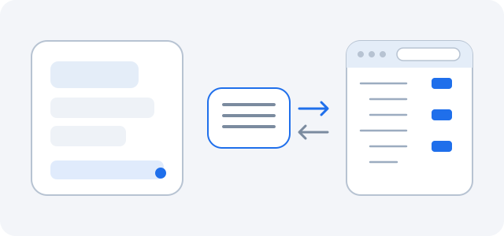

Aa Browser is an Electron browser that exposes its automation tool set over MCP. This bundle stages the browser's single-file MCP bridge and connects DeepSeek Harness to the running browser, so the agent can navigate, read structured page snapshots, click, type, capture network traffic, and use the rest of Aa Browser's tools.

## Prerequisites

- Aa Browser installed and running on Windows x64 or Linux x64. There is no macOS or Android build yet, so the bundle declares only those two Host platforms.
- DeepSeek Harness. The bundle reuses the `@deepseek-ai/dsh-mcp-client` package shipped with DSH and declares no npm dependencies.
- No system Node.js is required: the MCP row launches the staged bridge with DSH's own runtime (`process.execPath`, with `ELECTRON_RUN_AS_NODE=1` so the Electron-hosted Desktop build runs it as Node).

## How it connects

1. On activation the bundle's Host plugin copies its bundled `bridge.cjs` (built from the Aa Browser repository's `cli/mcp.mjs`) to `~/.aabrowser/dsh-bridge.cjs`. It creates the directory when needed and replaces the file atomically.
2. The same patch adds an `aa-browser` stdio MCP entry that runs that staged file. Its tools reach the agent as `mcp__aa-browser__<tool name>`.
3. The bridge finds the running browser through `~/.aabrowser/connection.json`, which Aa Browser writes, and talks to it over a WebSocket bound to 127.0.0.1 with a per-session token.

The plugin creates no listener and opens no remote connection of its own. Page content and tool results still travel to the selected model through DeepSeek Harness like any other tool result.

## Updates

- Aa Browser updates itself through its own updater; this plugin does not update, download, or start the browser.
- The plugin updates through the DSH marketplace, npm, a Git checkout, or a reinstalled local directory. Every activation re-stages the bundled bridge, so the MCP entry keeps pointing at the same stable path and needs no manual edit.
- After a plugin update, the new bridge takes effect on the next activation: a DSH restart, or a plugin reload where HMR is enabled.

## Limitations

- Host platforms are Windows x64 and Linux x64 only; there is no macOS or Android support yet.
- Tool names carry the server prefix: they appear as `mcp__aa-browser__*`, not as bare `browser_*` names.
- The MCP entry starts and lists its tools even when Aa Browser is closed, because the bridge is a separate stdio process. Browser tool calls cannot reach it until it is running; the bridge retries its connection every 5 seconds, so launching the browser is enough and no DSH reload is needed. A call made before the bridge reaches the browser may stay pending until the 180-second tool-call timeout, so start Aa Browser before calling browser tools.
- Some page actions can wait for a decision in Aa Browser's approval UI. The MCP client's call timeout is raised to 180 seconds to cover the browser's 120-second approval window.
- Screenshots come back as MCP image content. Whether the model can see them depends on the selected model's image support.
- The agent sees page content and captured network traffic, including cookies, storage, request headers, and response bodies. Treat a connected browser as readable by the agent.
