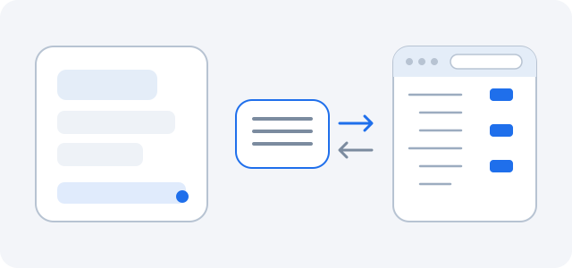

Aa Browser 是一个基于 Electron 的浏览器，通过 MCP 暴露整套自动化工具。这个插件把浏览器的单文件 MCP 桥落到固定路径，并把 DeepSeek Harness 接到正在运行的浏览器上，Agent 因此可以导航、读取结构化页面快照、点击、输入、抓包，以及使用 Aa Browser 的其余工具。

## 前提条件

- 在 Windows x64 或 Linux x64 上安装并启动 Aa Browser。目前没有 macOS 或 Android 版本，所以本插件只声明这两个 Host 平台。
- 已安装 DeepSeek Harness。插件复用 DSH 自带的 `@deepseek-ai/dsh-mcp-client`，不声明任何 npm 依赖。
- 不需要系统安装 Node.js：MCP 条目用 DSH 自己的运行时（`process.execPath`）启动桥；Electron 承载的 Desktop 版会带上 `ELECTRON_RUN_AS_NODE=1`，以 Node 方式运行它。

## 连接方式

1. 激活时，插件的 Host 部分把内置的 `bridge.cjs`（由 Aa Browser 仓库的 `cli/mcp.mjs` 构建）复制到 `~/.aabrowser/dsh-bridge.cjs`；目录不存在时自动创建，替换文件是原子的。
2. 同一份 patch 新增一个名为 `aa-browser` 的 stdio MCP 条目，运行上面这个固定路径的桥。工具以 `mcp__aa-browser__<工具名>` 的形式提供给 Agent。
3. 桥通过 Aa Browser 写入的 `~/.aabrowser/connection.json` 找到正在运行的浏览器，并用带会话 token 的 WebSocket（仅绑定 127.0.0.1）通信。

插件自身不创建监听端口，也不发起任何远程连接。页面内容和工具结果仍会像其他工具结果一样，经 DeepSeek Harness 发给你选择的模型。

## 更新行为

- Aa Browser 通过自带更新器自动更新；本插件不会更新、下载或启动浏览器。
- 插件通过 DSH 市场、npm、Git 仓库或重新安装本地目录来更新。每次激活都会重新落一次桥，所以 MCP 条目始终指向同一个固定路径，无需手动改配置。
- 插件更新后，新桥在下一次激活时生效：重启 DSH，或在启用 HMR 时重新加载插件。

## 限制

- 仅支持 Windows x64 和 Linux x64，暂无 macOS 或 Android 支持。
- 工具名带服务器前缀，显示为 `mcp__aa-browser__*`，而不是裸的 `browser_*`。
- 即使 Aa Browser 没有运行，MCP 条目也会启动并列出工具，因为桥本身是独立的 stdio 进程。第一次调用浏览器工具时，桥会从受信安装路径自动启动 Aa Browser，并等待连接最多 30 秒，无需重载 DSH。无法自动检测安装位置时，可设置绝对路径环境变量 `AA_BROWSER_APP_PATH`；设置 `AA_BROWSER_AUTO_LAUNCH=0` 可禁用自动启动。
- 部分页面操作可能等待 Aa Browser 的审批界面。MCP 客户端的调用超时已提高到 180 秒，覆盖浏览器默认 120 秒的审批等待窗口。
- 截图以 MCP 图片内容返回；模型能否看到图片取决于所选模型是否支持图片输入。
- Agent 可以看到页面内容和抓到的网络流量，包括 Cookie、Storage、请求头和响应体。请把已连接的浏览器视为 Agent 可读。
